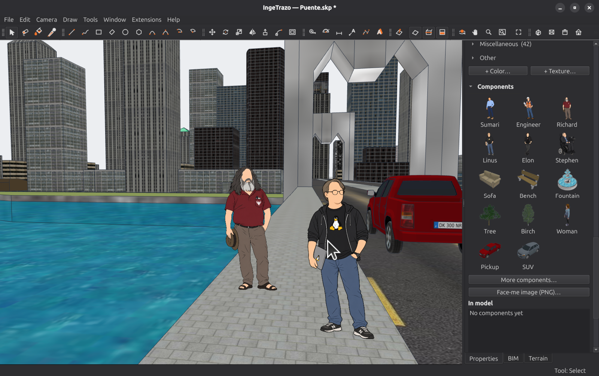
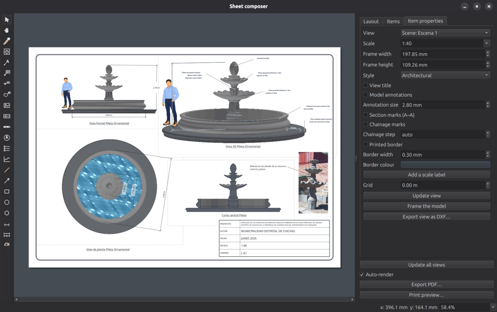

# IngeTrazo

Bahasa Indonesia · [English](README.md) · [Español](README.md#en-español)

*Dibaca **in-he-TRA-so**, dari bahasa Spanyol inge(niería), yang berarti
teknik, dan trazo, yang berarti goresan gambar: goresan seorang insinyur.*

**Aplikasi pemodelan 3D bebas untuk arsitektur, teknik, dan desain 3D.
Menggambar seperti membuat sketsa dengan tangan, dengan dukungan native untuk Linux.**


IngeTrazo menghadirkan pemodelan *dorong/tarik* di Linux, yang masih memiliki
sedikit pilihan CAD native untuk insinyur sipil, arsitek, dan siapa pun yang
merancang furnitur, benda, scene, atau model 3D. Geometrinya bisa digambar
bebas seperti sketsa tangan. Dukungan **tag BIM opsional** menghubungkan
geometri dengan kelas `IfcWall`, `IfcSlab`, atau `IfcColumn` untuk diekspor
ke IFC. Bersama proyek saudaranya, [IngePresupuestos](https://ingepresupuestos.com),
alur kerjanya menjadi **model → tag → perhitungan kuantitas → anggaran**.



> Nama IngeTrazo berangkat dari *trazar*: menggambar garis seperti dengan tangan.

## Status

**Sudah dapat digunakan untuk pekerjaan nyata.** Menggambar, mengekstrusi,
mengedit, mengecat, memberi dimensi dan anotasi; membuka berkas `.skp` dari
2013 sampai 2026; memberi kelas BIM dan mengekspor kuantitas IFC; serta
menetapkan georeferensi dan mengimpor data survei.

IngeTrazo dikembangkan sambil dipakai dalam proyek teknik nyata dan didukung
ribuan pengujian otomatis. Mesin geometrinya menolak perubahan yang merusak
solid tertutup, sehingga perhitungan kuantitas tetap dapat diandalkan.
Versinya masih 0.x: format berkas dan API plugin bisa berubah antarversi minor,
dan beberapa bagian masih perlu diperbaiki. Jika menemukan masalah,
[laporkan melalui issue](https://github.com/ingelibre/ingetrazo/issues).

## Pemasangan

Unduh paket dari [rilis terbaru](https://github.com/ingelibre/ingetrazo/releases/latest).

- **Windows:** gunakan installer `-setup-` atau paket portabel `.zip`.
- **Linux (x86_64):** gunakan **Flatpak dari repositori IngeTrazo** agar
  pembaruan tersedia melalui `flatpak update`. Aplikasi muncul di menu
  aplikasi, dan berkas `.igz` serta `.skp` dikaitkan dengannya.

```bash
flatpak remote-add --user --if-not-exists ingetrazo https://ingetrazo.com/ingetrazo.flatpakrepo
flatpak install --user ingetrazo com.ingetrazo.IngeTrazo
flatpak run com.ingetrazo.IngeTrazo
```

Rilis juga menyediakan berkas tunggal `IngeTrazo.flatpak` yang dapat dibuka
dengan klik dua kali. Paket ini tidak memiliki saluran pembaruan, sehingga
versinya tetap seperti saat dipasang. Pilihan lainnya adalah **AppImage**
(beri izin eksekusi, lalu jalankan) atau **arsip tar** jika distro tidak
menyediakan FUSE:

```bash
chmod +x IngeTrazo-*-x86_64.AppImage && ./IngeTrazo-*-x86_64.AppImage
# or
tar -xzf IngeTrazo-*-linux-x86_64.tar.gz && IngeTrazo-*/ingetrazo
```

Python, Qt, dan pembaca `.skp` berbasis Python sudah disertakan dalam paket.
Opsi `--check` menampilkan hasil pemeriksaan pemasangan dan mengembalikan
kode keluar selain nol jika ada komponen yang hilang.

- **macOS** (Apple Silicon, M1 atau lebih baru): unduh
  `IngeTrazo-<version>-macos-arm64.dmg` dari
  [rilis terbaru](https://github.com/ingelibre/ingetrazo/releases/latest),
  buka, lalu seret IngeTrazo ke Applications. Aplikasi belum ditandatangani
  secara digital. Saat pertama kali membukanya, klik kanan lalu pilih Open.
  Impor DWG belum tersedia di macOS karena `dwg2dxf` saat ini hanya untuk
  Linux. Pembaca `.skp` native berjalan di semua platform. Jika terjadi
  masalah, [buat issue](https://github.com/ingelibre/ingetrazo/issues) dan
  sertakan keluaran Terminal.

Untuk mulai mencoba, buka salah satu dari empat dokumen proyek penataan
alun-alun Yanque dalam folder [`examples/`](examples/README.id.md): air mancur,
bangku dengan pergola, tiang lampu tenaga surya, atau gapura dengan seluruh
tulangannya. Tiga dokumen pertama dilengkapi lembar A3 dan PDF. Berkas contoh
juga disertakan pada setiap rilis sebagai `IngeTrazo-ejemplos.zip`.

## Memakai bahasa Indonesia

Buka **Preferensi**, pilih **Bahasa Indonesia** pada pengaturan **Bahasa**,
lalu mulai ulang IngeTrazo jika diminta. Terjemahan antarmuka tersimpan di
[`i18n/id.json`](i18n/id.json).

Dokumentasi ini memakai istilah CAD yang umum: **layer** untuk mengatur
entitas dan **scene** untuk menyimpan tampilan kamera beserta visibilitas
layer. Menu **Penyusun lembar** digunakan untuk menata gambar berskala pada
kertas.

Panduan penggunaan: [Layer](docs/layers.id.md) serta
[tab proyek, scene, dan tampilan](docs/project-tabs.id.md).

## Fitur yang tersedia

- **Area model:** kamera dengan sumbu Z ke atas, orbit berpusat pada titik
  di bawah kursor, kisi, sumbu berwarna, proyeksi perspektif dan paralel,
  perspektif dua titik, tampilan standar, zoom seluruh model, penghilangan
  garis tersembunyi, dan bayangan sesuai posisi matahari.
- **Jelajah:** Posisikan Kamera, Berjalan, dan Lihat Sekeliling pada tinggi mata.
- **Alat gambar:** Garis, Persegi panjang, Persegi Panjang Putar, Lingkaran,
  Poligon, Busur dua titik dan tiga titik, dengan inferensi, snap, kunci
  sumbu, dan kotak nilai untuk memasukkan panjang atau koordinat secara
  tepat. Gunakan `200,100` atau `200;100` untuk dua nilai. Tersedia juga
  gambar tangan bebas, juring, teks 3D, dan gambar. **Ulangi perintah terakhir**
  dengan Shift+R atau menu klik kanan.
- **Dorong / Tarik:** ekstrusi, cekungan, undakan, dan lubang tembus dengan
  pemeriksaan solid. Perubahan yang merusak solid tertutup ditolak agar
  geometri tetap layak dipakai untuk perhitungan kuantitas BIM.
- **Offset:** buat dinding dengan ketebalan dari kontur bidang.
- **Ikuti Jalur dan Pembulatan:** ekstrusi profil sepanjang jalur dan
  bulatkan sudut.
- **Pindahkan, Skala, dan Balik:** dengan snap, inferensi, dan masukan ukuran tepat.
- **Pita Ukur dan garis bantu:** titik serta garis bantu menjadi acuan snap
  bagi semua alat, termasuk Dorong / Tarik untuk menghentikan bidang tepat
  pada tinggi garis bantu.
- **Pengeditan:** Penghapus, Sembunyikan/Tampilkan, Balik Pilihan, dan Iriskan Bidang.
- **Alat solid:** Cangkang Luar, Gabungan, Kurangi, Pangkas, Irisan, dan Belah.
- **Bidang potong:** lihat potongan model secara langsung dengan isian potongan.
- **Grup dan komponen:** pisahkan geometri agar dapat dipindahkan, dibongkar,
  atau diedit sebagai satu kesatuan. Salin/tempel menampilkan pratinjau
  solid bertekstur di bawah kursor. Salinan komponen memakai definisi
  bersama. **Tempel di Tempat** (Ctrl+Alt+V) menempatkan salinan tepat pada
  posisi asal, sehingga objek dapat dipindahkan ke dalam atau ke luar grup
  tanpa bergeser.
- **Putar dan Busur derajat:** inferensi bidang, cakram berwarna sesuai sumbu,
  snap setiap 15° di dekat cakram, masukan kemiringan sebagai tinggi:jarak
  mendatar (`3:12`), putar salinan dengan Ctrl, penetapan sumbu putar dengan
  menyeret, dan garis bantu miring. Klik titik snap untuk memutar tepat
  sesuai sudut menuju titik tersebut.
- **Gaya tampilan:** Bawaan, Arsitektural (tekstur di atas putih), Berbayang,
  Garis tersembunyi, Monokrom, Kerangka kawat, dan Sinar-X. Scene menyimpan
  gayanya; setiap tampilan dalam penyusun lembar juga dapat memakai gaya berbeda.
- **Solid lengkung:** tepi halus, silinder yang tampak mulus, pemilihan
  permukaan lengkung, serta garis profil dan siluet yang mengikuti arah pandang.
- **Material:** warna per bidang dan tekstur dengan proyeksi planar serta
  ukuran nyata, diterapkan melalui alat Cat. Material memiliki nama dan
  identitas: mengedit lalu menerapkannya ulang memperbarui semua pemakaiannya.
  Info Model melaporkan kuantitas per material, dan nama material ikut diekspor.
- **Dimensi dan teks penunjuk:** anotasi statis dengan gaya dan oklusi garis
  tersembunyi. Teks dipilih melalui bentuk hurufnya, dapat dipindahkan
  dengan titik acuan tetap, dan diedit dengan klik dua kali. Keduanya juga
  dapat diimpor dari `.skp`.
- **Panel samping:** Info entitas, Layer, Scene, Material (213 warna RAL dan
  pustaka tekstur berukuran nyata), Komponen (figur pembanding skala,
  furnitur, pohon, kendaraan, dan PNG sendiri yang selalu menghadap kamera),
  serta Gaya dimensi.
- **Impor `.skp`:** buka langsung, termasuk dengan klik dua kali, dari
  format klasik 2013 sampai 2020 dan format 2021 ke atas. Material, tekstur,
  material pada kedua sisi bidang, transparansi, layer, scene, dimensi, dan
  teks penunjuk ikut dibaca. Pembaca berbasis Python ini bekerja luring
  dengan [OpenSKP](https://github.com/iamahsanmehmood/openskp), yang dijelaskan
  pada bagian [Ucapan terima kasih](#ucapan-terima-kasih). Ekspor `.skp`
  belum tersedia; gunakan COLLADA `.dae`, OBJ, atau glTF untuk membuka model
  di program lain.
- **Berkas:** simpan/buka `.igz` yang menyertakan tekstur di dalam dokumen;
  impor STL (dengan penggabungan bidang sebidang pada bidang utama atau
  seluruh permukaan melalui opsi lanjutan), OBJ, dan COLLADA `.dae`;
  ekspor STL, OBJ, COLLADA, serta glTF/GLB. glTF memuat material PBR dan
  geolokasi. STL dapat langsung dibuka di slicer; alat khusus cetak 3D masih
  direncanakan.
- **Layer dan scene:** atur visibilitas serta kunci entitas, dan simpan
  tampilan kamera beserta visibilitas per layer untuk membuat beberapa
  gambar dari satu model. Keduanya juga dibaca dari `.skp`.
- **Tag BIM dan ekspor IFC:** tetapkan kelas IFC pada geometri bebas,
  seperti dinding, pelat, dan kolom. Objek bertag diekspor ke `.ifc`
  beserta kuantitasnya: luas selalu dihitung, sedangkan volume hanya
  dihitung untuk objek yang tertutup rapat. Hasilnya dapat dipakai dalam
  perhitungan kuantitas di [IngePresupuestos](https://ingepresupuestos.com).
- **Georeferensi:** datum UTM, ubin peta dasar daring, medan 3D dari DEM,
  jalur geografis dengan profil memanjang yang diperbarui langsung, impor
  CSV titik survei dari total station atau GPS, serta impor mesh
  fotogrametri dari WebODM/ODM.
- **Penyusun lembar:** tata tampilan model berskala pada kertas. Tersedia
  render vektor dengan garis tersembunyi dihapus, tiga ketebalan pena,
  isian potongan, judul tampilan bernomor, tanda lokasi potongan seperti
  A-A, dimensi yang terpaut pada model, dimensi berantai dengan total
  bertingkat, tanda elevasi, rujukan detail, kop gambar, ekspor PDF vektor,
  dan DXF dengan layer terpisah untuk setiap kelas garis.
- **Ekstensi:** letakkan berkas Python di folder plugin agar alatnya muncul
  dalam menu **Ekstensi**. Contoh bawaan meliputi **Info Model**, **Konsol
  Python** untuk menjalankan skrip pada dokumen aktif dengan dukungan
  Urungkan, **Pemeriksa Solid**, **Asisten AI** di dalam aplikasi
  (Groq/Claude/GPT/Gemini/OpenRouter/DeepSeek/Ollama lokal), dan **Jembatan AI**
  untuk mengendalikan dokumen melalui MCP dari Claude Code/Desktop.
  Setiap tindakan AI menjadi satu langkah yang dapat diurungkan secara utuh.
  Plugin yang gagal tidak menghalangi IngeTrazo untuk dijalankan.
  Lihat [panduan plugin](docs/plugins.md) untuk mulai berkontribusi.
- **Urungkan/Lakukan Ulang:** setiap pengeditan menjadi satu langkah utuh,
  termasuk skrip konsol.



## Rencana pengembangan

[README utama](README.md#planned) mencatat rencana berupa garis kontur dari
medan, sumbu acuan, label ruang, legenda bernomor pada lembar, DWG/DXF
bersama [IngeCAD](https://ingecad.org), impor IFC, antarmuka pengelola
ekstensi, dan distribusi melalui Flathub. Sebagian fitur dalam daftar
tersebut, seperti pengelola ekstensi, sudah tersedia. Periksa
[ROADMAP.md](ROADMAP.md) dan [CHANGELOG.md](CHANGELOG.md) untuk status
pengembangan dan perubahan terbaru.

## Mengapa IngeTrazo dibuat

Insinyur sipil yang bekerja di Linux belum memiliki banyak pilihan aplikasi
pemodelan 3D native: program yang umum dipakai sering tidak menyediakan versi
Linux atau sulit dipelajari. IngeTrazo dibuat untuk kebutuhan tersebut,
dengan Linux sebagai platform utama, antarmuka awal berbahasa Spanyol,
lisensi perangkat lunak bebas, dan alur kerja yang berangkat dari lokasi
proyek bergeoreferensi hingga pemberian tag untuk menghitung kuantitas.

## Teknologi

Komponen inti dibuat sesedikit mungkin. Dependensi tambahan dipakai saat
fitur membutuhkannya.

| Bagian | Teknologi |
|---|---|
| Antarmuka | PySide6 6.11 (Qt 6) |
| Render 3D | OpenGL bawaan Qt (`QOpenGLShaderProgram` / `QOpenGLBuffer` / VAO), GLSL 3.30 Core |
| Matematika 3D | `QMatrix4x4` / `QVector3D` dari QtGui |
| Pengemasan vertex | `array` dari pustaka standar Python |
| Snap dan inferensi | Implementasi sendiri dalam `core/snap.py` |
| Pengujian | pytest |

Daftar dependensi lengkap ada di [`requirements.txt`](requirements.txt).

## Mulai dari kode sumber

```bash
git clone https://github.com/ingelibre/ingetrazo.git
cd ingetrazo
python3 -m venv venv
source venv/bin/activate          # Linux / macOS
# .\venv\Scripts\activate         # Windows
pip install -r requirements.txt
python main.py
```

Pengembangan memakai Python 3.14. Panduan kontribusi mensyaratkan
**Python 3.12 atau lebih baru**. Jalankan pengujian dengan
`python -m pytest -q`. Panduan [kontribusi Indonesia](CONTRIBUTING.id.md)
menjelaskan penyiapan lingkungan, pengujian per kelompok, dan alur pull request.

## Berkontribusi

Kontributor dari mana pun dipersilakan. Baca
[panduan kontribusi](CONTRIBUTING.id.md) dan [kode etik](CODE_OF_CONDUCT.id.md).
Kode, komentar, pesan commit, dan deskripsi pull request ditulis dalam
**bahasa Inggris** agar dapat dipahami kontributor dari berbagai negara.
Terjemahan antarmuka disimpan sebagai satu berkas JSON per bahasa dalam
folder `i18n/`.

## Ucapan terima kasih

Semua kontributor dicantumkan dalam [AUTHORS](AUTHORS) dan menu
**Bantuan ▸ Tentang IngeTrazo**. Kontributor dengan sumbangan terbesar
ditandai ★.

- **★ [Pedro Caeiro](https://github.com/pacaeiro):** juru gambar arsitektur
  dan mekanik, dengan sekitar dua puluh pull request yang telah digabung
  dan lebih dari seratus laporan masalah dari pekerjaan nyata. Ia memakai
  IngeTrazo setiap hari dan mencatat perilaku alat yang belum sesuai
  kebutuhan juru gambar. Laporan tersebut membantu memperbaiki banyak
  interaksi sehari-hari.
- **★ [Gabriel Rodríguez Arregin](https://github.com/canalsecuario-blip):**
  arsitek dengan sekitar tiga puluh pull request yang telah digabung,
  termasuk sistem satuan, Penjelajah, Pemeriksa Solid, pemotongan miring
  pada Pembulatan 3D, Gabungkan segmen, dan banyak alat pengeditan.
- **★ [Félix Riestra](https://github.com/felixriestra):** IngeTrazo untuk Mac,
  komponen yang dapat dipisahkan menjadi bagian, dan Extension API 2.
- **★ Rafael García Rodríguez**, melalui
  [Rafael 3D](https://www.youtube.com/@Rafa3D): juru gambar dan pengulas.
  Ulasan videonya menguji program dalam pekerjaan profesional dan mendorong
  pengembangan penyusun lembar. Tutorial standar gambar tekniknya, dengan
  gambar acuan dari AutoCAD, menjadi dasar pengembangan dimensi IngeTrazo.
- **★ [OpenSKP](https://github.com/iamahsanmehmood/openskp)** oleh Ahsan
  Mehmood, berlisensi MIT: pembaca `.skp` berbasis Python yang dikembangkan
  secara independen dan digunakan untuk impor native IngeTrazo. Proyek ini
  juga mengirim perbaikan ke OpenSKP untuk material, tekstur, pemetaan UV
  per bidang, entitas gambar, warna gaya, material sisi belakang, pengaturan
  tepi, serta pembaca format kontainer MFC sebelum 2021. Gunakan OpenSKP jika
  perlu membaca `.skp` dari Python, dan dukung proyeknya dengan bintang.
- **[dafrobozao](https://github.com/dafrobozao):** terjemahan Portugis Brasil
  (#54), bahasa ketiga IngeTrazo.
- **[liuandy](https://github.com/liujvnes):** terjemahan Tionghoa Sederhana
  (#123), bahasa keempat IngeTrazo.
- **[deedend](https://github.com/deedend):** terjemahan Italia (#182), bahasa
  kelima IngeTrazo. Kemudian menyusul bahasa Indonesia oleh
  [Rainjalin](https://github.com/Rainjalin), Prancis oleh
  [Yann Steffan](https://github.com/YannFR81), Jerman oleh
  [PESI3D](https://github.com/PESI3D), Polandia oleh
  [Piotr Szmitkowski](https://github.com/jackalski), Rusia oleh
  [RomanErshow](https://github.com/RomanErshow), Vietnam oleh
  [vandang890615](https://github.com/vandang890615), Laos oleh
  [BoneNI](https://github.com/bounkirdni-2025), Thai oleh
  [Prida Takon](https://github.com/PRIDA-TAKON), Jepang oleh
  [nonasige-ui](https://github.com/nonasige-ui), dan Korea oleh
  [ChangWoo Lee](https://github.com/ultracat).

## Lisensi

[GPL-3.0-or-later](LICENSE), keluarga lisensi copyleft yang juga dipakai
Blender, FreeCAD, dan PrusaSlicer. Anda bebas menggunakan, mempelajari,
mengubah, dan mendistribusikan ulang IngeTrazo, dengan syarat karya
turunannya tetap memakai lisensi yang sama.

## Pembuat

**Marco Sumari Tellez**, insinyur sipil dari Arequipa, Peru.
Lihat [AUTHORS](AUTHORS).

---

IngeTrazo adalah proyek independen yang ditulis dari awal dan tidak
berafiliasi dengan produsen perangkat lunak lain. Format berkas yang
dibacanya tetap menjadi milik pemilik masing-masing.

Dokumen ini menerjemahkan [README utama](README.md). Untuk informasi sumber
dan perubahan terbaru, rujuk dokumen tersebut.
