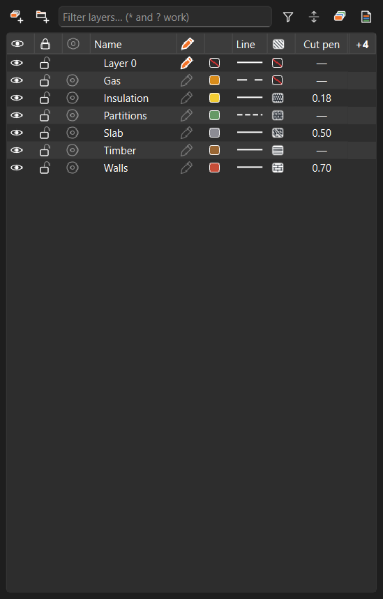
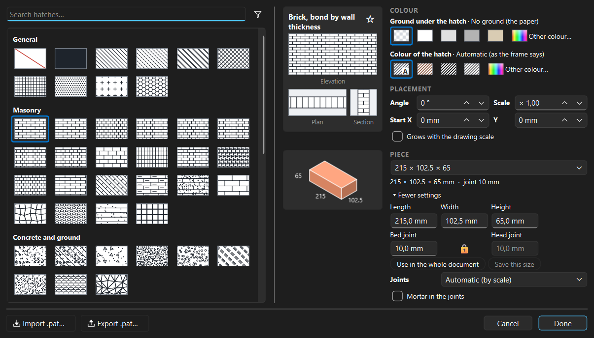
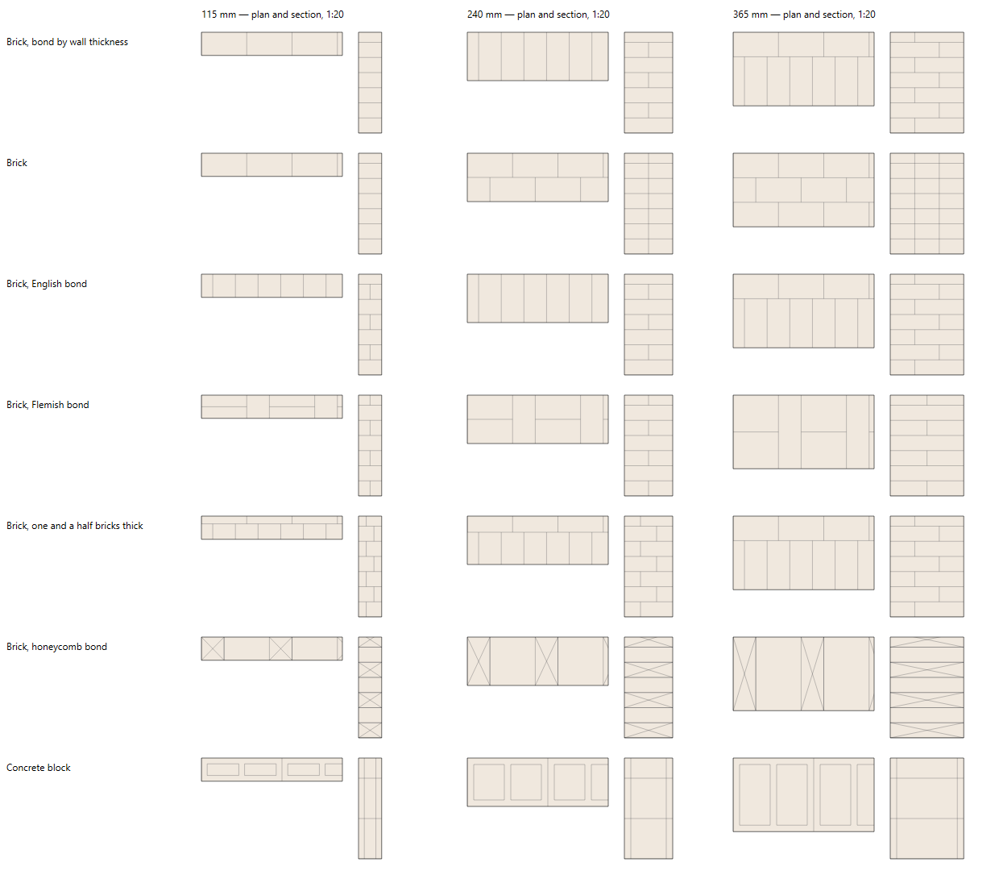
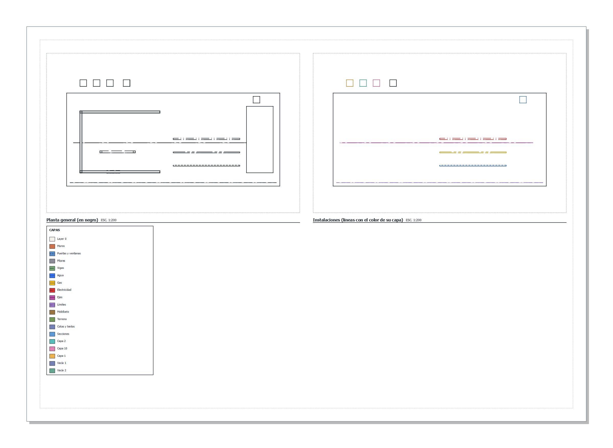
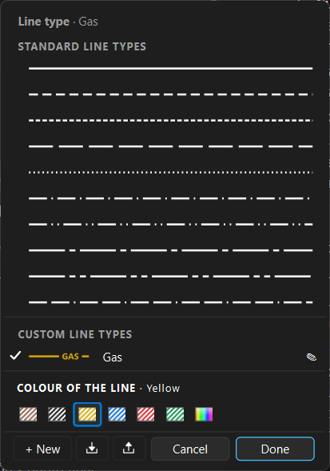
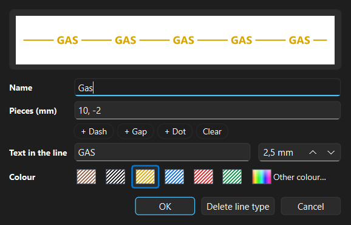
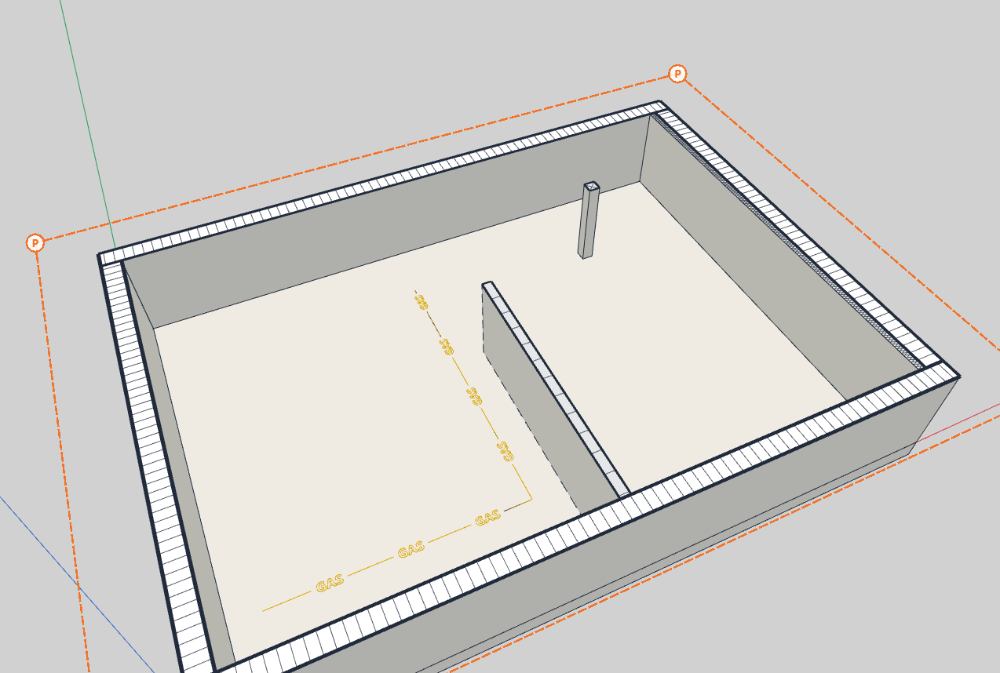
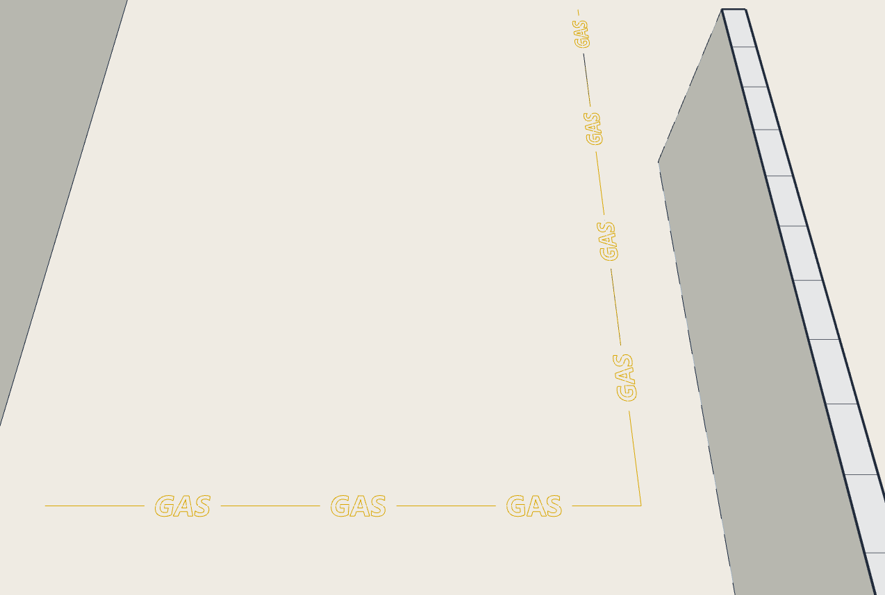

# Cut, hatches and line types

A guide to how each layer comes out where a section plane cuts it — its
pen, its material, its masonry drawn brick by brick — and to the line types
a layer is drawn with, on the sheets, in the DXF and in the 3D view.

The reference for every setting is the [Layers](layers.md) manual (sections
5, 10 and 11); the [hatch catalogue](hatches.md) shows every pattern with its
use. The pictures here come from a small example: brick walls with an
insulation layer, a concrete slab, a hollow brick partition, timber and a gas
line, cut by a plan section plane.

---

## 1. In short

| You want… | Where |
|---|---|
| A heavier pen for the walls' cut | Layers panel ▸ **Cut pen** column |
| Brick, concrete, insulation… in the cut | Layers panel ▸ **Hatch** column ▸ the hatch picker |
| Bricks drawn as they are laid, at their real size | Hatch picker ▸ a masonry pattern ▸ **Piece** |
| The same on screen, in the 3D view | Browser ▸ right-click the section plane ▸ **Fill of this cut ▸ Layers' hatches** |
| A gas line dashed, yellow, with «GAS» along it | Layers panel ▸ **Line** column ▸ the line type panel |
| All of it in a CAD program | Composer ▸ **Export view as DXF…**, or **File ▸ Export ▸ Current view as DXF** |

---

## 2. The two columns of the cut

- **Cut pen** (off by default: the columns button at the end of the header,
  or a right-click on the header): the pen of the layer's section cut on the
  sheets — walls at 0.70, partitions at 0.35, doors and windows at 0.25. «—»
  uses the sheet's cut pen. The layer's other lines keep their own weight.
- **Hatch**: what the layer's cut is filled with. A click opens the hatch
  picker; a red slash means no hatch of its own (the frame's fill).

A click on a cell of either column selects that layer's row, so you always
see which layer you are setting; with several rows selected, the choice goes
to all of them.

---

## 3. The hatch picker

It opens in the middle of the screen, always in the same place.

**On the left, the catalogue.** 78 patterns in 8 groups. Type in the search
field to narrow it; the funnel beside it shows one group at a time
(Masonry, Wood…). Your **favourites** (☆ beside a pattern's name, or a
right-click on its tile) and the **recently used** come first. The arrow keys
walk the patterns.

**On the right, how the chosen one is laid:**

- **The preview**: the pattern in elevation, and below it the same wall cut
  in **plan** and in **section**, so you see how a bond turns with the cut.
- **Colour**:
  - *Ground under the hatch* — the paper, white, light grey, grey, the
    layer's colour made light, or any other.
  - *Colour of the hatch* — **Automatic** (marked «A»: as the sheet's frame
    says), the layer's colour, black, dark grey, or any other.
  - **Other colour…** opens a colour chooser over the picker; the picker
    stays open behind it.
- **Placement**: the angle (steps of 15°), the scale, **Start X / Y** (only
  for patterns made of pieces, see section 4) and **Grows with the drawing
  scale** — off, the pattern measures the same on paper at any scale; on, it
  grows with the frame's scale like real bricks or tiles. Materials with a
  real size grow by themselves.
- **Wood** and **Piece**: only when the pattern needs them (sections 4
  and 5).

**Every click shows at once** in the model and on the sheets. Only **Done**
(or Enter) keeps the changes; **Cancel**, Esc or a click outside the picker
put the layer back as it was.

**Pattern files.** **Import .pat…** brings the patterns of a `.pat` file into
the document (they appear in their own group); **Export .pat…** writes the
patterns drawn with lines to a `.pat` file other drawing programs open.

---

## 4. Masonry, as it is built

A masonry pattern is not a texture: in a **plan** it draws the top of a
course, brick by brick along each wall; in a **section**, the courses level,
with the inner joint the bond asks for.

- **Brick, bond by wall thickness** picks the bond each wall's thickness
  needs — a partition, half a brick, one brick, one and a half. Or choose the
  bond yourself: stretcher, header, English, Flemish cross, Flemish, Dutch,
  one and a half brick, on edge, rowlock, honeycomb.
- The other pieces: hollow brick (ticholo), load-bearing ceramic block
  (rejillón), precast concrete brick with holes, concrete block, aerated
  concrete block, ashlar.

**Piece** (in the picker):

- The list gives the usual sizes of that kind of piece, by their measures
  (length × width × height). Under **More settings** you type your own:
  length, width, height and the two joints — the **bed joint** (horizontal,
  under each course) and the **head joint** (vertical, between two bricks).
  The padlock between them keeps them equal; open it to set each.
- **Save this size** keeps your measures in the list of that kind of piece,
  marked ★, in every document. On one of your sizes the button reads
  **Remove from the list**.
- **Use in the whole document** gives the piece to every layer of that kind
  at once; a layer can still set its own afterwards.
- The piece is drawn in isometric under the preview, with its dimensions.

**Joints**: *Automatic (by scale)* draws a 45° hatch at 1:75 and smaller
(bricks would blur), the joints as single lines from 1:50 to 1:20 and at
their real thickness at 1:15 and larger. Or fix it: single line, double (real
thickness) or none (the outline only). **Mortar in the joints** fills the
double joints in light grey.

**Where the pieces start.** Each wall starts as it is laid: a whole brick at
its end — a corner, a jamb — and its first course at its foot. **Start X**
moves the first joint along the wall (in a plan), **Start Y** the first
course up the wall (in a section), in real millimetres. Tiles, boards,
parquet and pavers move both ways, to start from an axis or a border.

---

## 5. Wood and insulation

- **Wood**: the grain follows the 3D piece. With **Cross where cut across the
  grain**, a piece cut across — a post, a joist, a beam in section — gets a
  cross from corner to corner; boards and beams cut along keep the grain. The
  model decides which is which: a piece that runs on through the cut further
  than it spreads within it is cut across.
- **Insulation** (batts and zigzag) is fitted to each piece: the symbol spans
  the layer's thickness, however thick.

---

## 6. On the sheets

A view frame cut by a section plane draws each layer's cut with its pen and
its hatch. In the frame's properties:

- **Fill in each layer's colour** fills each cut with the colour of its layer
  (Layer 0 keeps the frame's fill).
- **Hatches** (in the pens): the pen of every hatch's lines, the same for all
  materials. Automatic: 70 % of the Edges pen.

The sheet's **legend** shows each layer's hatch.

---

## 7. Line types

A click on a layer's **Line** cell opens the line type panel, in the middle
of the screen like the hatch picker, with the layer it works on named at the
top:

- **The lines**: the standard ones (their names on hover) and, under
  **Custom line types**, the document's own. A click picks one; the panel
  stays open.
- **Colour of the line**: by layer (the layer's colour, as before), black,
  yellow, blue, red, green or any other. The colour belongs to the **line
  type**: every layer drawn with it takes it — a gas line yellow, a water
  main blue. It works for the standard line types too; their colours are
  kept in the document.
- At the foot: **+ New**, import and export `.lin` files, **Cancel** and
  **Done**. As in the hatch picker, only **Done** (or Enter on a line) keeps
  the change.

**Your own line types.** **+ New** — or the pencil beside one of yours —
opens the editor:

- **Name**, and the **pieces** in millimetres on paper: a dash `6`, a gap
  `-1.5`, a dot `0` — typed, or added with the buttons.
- **Text in the line**: words written along it in a gap of their own (GAS,
  WATER, ELEC…), with their height on paper.
- **Colour**, as in the panel.
- **Delete line type** (when editing): its layers go back to continuous.

Line types travel in the document and in the layer templates. **Import
.lin** reads the line type files drawing programs share, with their text;
those with shapes inside are left out, and the import says which.

---

## 8. In the 3D view

**The cut.** Right-click the section plane in the Browser ▸ **Fill of this
cut ▸ Layers' hatches**: each layer's cut shows its hatch, as a sheet at 1:50
draws it (bricks and joints at their real size), and the cut line takes each
layer's cut pen. A layer without a hatch keeps the plane's fill colour.

**The line types.** **Line types in the model** (the Layers panel's options
button; on unless a style turns it off) draws each layer's edges with its
line type: dashed as a sheet at 1:50 draws them, in the line type's colour,
with its text.

Both are settings of what you see: scenes remember them with their style,
and they change nothing in the model.

---

## 9. In the DXF

**Export view as DXF…** (composer) and **File ▸ Export ▸ Current view as
DXF** (a parallel view, drawn at 1:50) write, for each model layer:

| DXF layer | What |
|---|---|
| `<layer>-CORTE` | its cut, continuous, in its colour |
| `<layer>-TRAMA` | its hatch, as lines clipped to the cut |
| `<layer>-FONDO` | the ground under its hatch, as SOLID |

A **solid** hatch goes out as SOLID too. DXF R12 has no hatch entity, so any
CAD program shows the lines and fills as they are. The line types of your own
are declared in the file by their name, their text as TEXT along the lines.

---

## 10. Good to know

- **Undo**: as with the other looks of a layer (colour, line type, weight),
  hatch and line type settings are not steps of the undo history; **Cancel**
  in the picker is the way back.
- **Sizes of your own** (★) are kept on this computer, for every document;
  the pieces a document uses travel inside it.
- **Without a section plane** nothing is cut, so no hatch shows; the line
  types still do.
- **Arabic and other right-to-left languages**: the panels are mirrored; the
  previews and line samples, being drawings, stay as they are.
