# Export the view as SVG

**File ▸ Export ▸ Current view as SVG…** writes what the view shows as a
vector drawing, ready to finish in an illustration program: one layer per
model layer, every visible face a filled shape of its own under the lines,
with its colour or its texture as the view lays it. In the sheet composer,
**Export view as SVG…** does the same for the frame in front, at the frame's
scale and with its pens.

Everything here can be tried with any model that has materials, a texture and
the sun's shadows switched on.

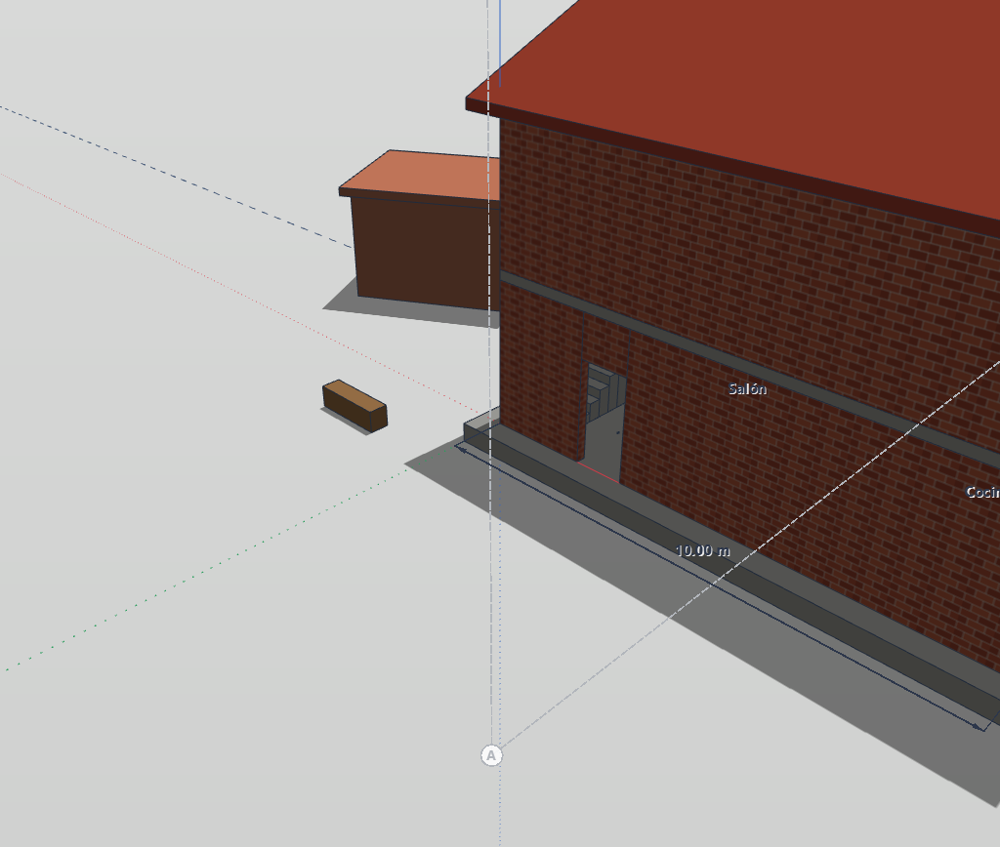

---

## 1. The quick dialog

The dialog opens compact: what to export and how big.

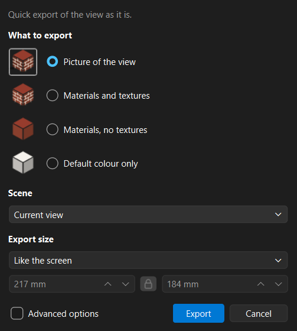

| Choice | What you get |
|---|---|
| **Picture of the view** | The view exactly as on screen — shadows, ambient occlusion, textures — as one picture under the vector lines. Quick, and the closest to the screen; its faces are not shapes to edit. |
| **Materials and textures** | Each visible face as one filled shape, with its colour or its texture placed as the view places it (in perspective too). |
| **Materials, no textures** | The same shapes in the material's flat colour. |
| **Default colour only** | The same shapes in IngeTrazo's white, lighter or darker by the way each face turns to the light — the materials left out. |

**Scene** — only when the model has scenes: *Current view* or one of the
scenes (see [Scenes](#scenes)).

**Export size**

- **Like the screen** — the millimetres the window has on screen (at
  96 dpi), shown but not editable.
- **Custom (mm)** — your own width and height, starting from the screen's.
  With the padlock closed, change one and the other follows in the same
  proportion; open, each one is free.

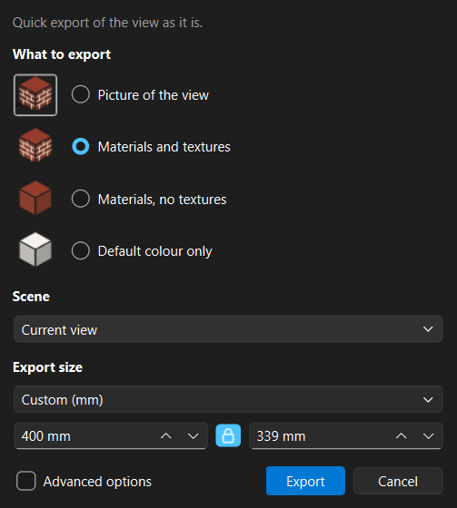

The dialog remembers what you chose for the next time.

---

## 2. Advanced options

Tick **Advanced options**, at the bottom left, for the full dialog. Untick it
to go back: each one takes over what the other had chosen. The dialog stays
centred on the window as it grows and shrinks.

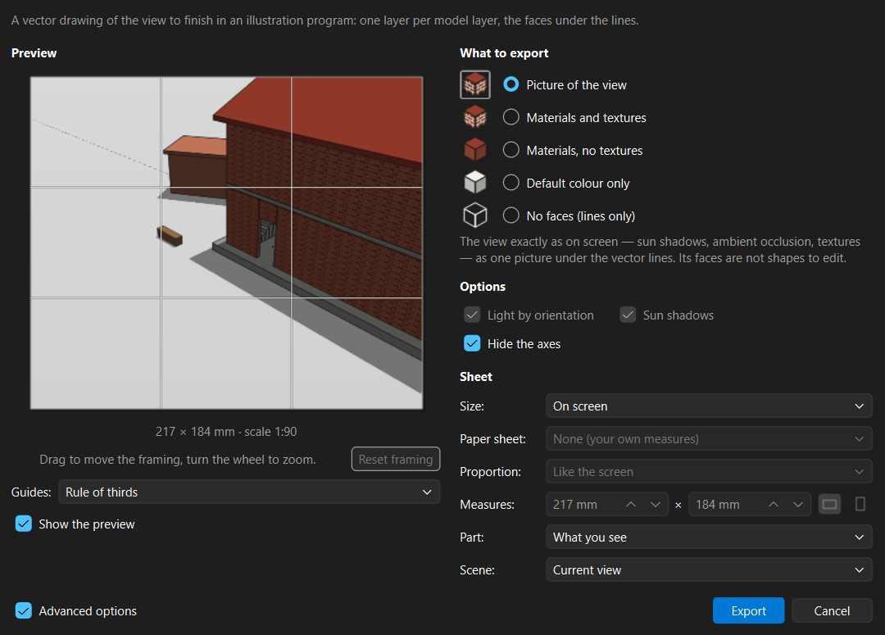

### Preview and framing

- The preview is the sheet as it will be exported.
- **Drag** in it to move the framing and **turn the wheel** to zoom;
  **Reset framing** goes back to what the screen shows. Framing is there
  for *What you see*.
- **Guides** — rule of thirds (the default), golden ratio, grid,
  diagonals, centre — are drawn over the preview to frame by. They are
  never exported.
- **Show the preview** off works nothing out until **Export**: quicker on
  a big model.

### What to export

The four choices of the quick dialog, plus **No faces (lines only)**.

### Options

| Option | |
|---|---|
| **Light by orientation** | Each face lighter or darker by the way it faces, as the view shades it. Off: the flat colour. |
| **Sun shadows** | The sun's shadows as shapes of their own: a *-SOMBRAS* layer per model layer and *SOMBRAS-SUELO* for the ground. Switch the shadows on in the view to export them. |
| **Hide the axes** | The picture of the view without the red, green and blue axes. |

### Sheet

| Field | |
|---|---|
| **Size** | *On screen* or *Custom*. From the sheet composer, also the frame's scale: the drawing at that scale, the sheet as big as it needs. |
| **Paper sheet** | A4 to A0, with *Custom* only. |
| **Proportion** | Free, like the screen, square, 16:9, 4:3, 3:2, 2:1 — with *Custom* and no paper sheet. |
| **Measures** | Width × height in mm, landscape or portrait. |
| **Part** | *What you see* or *Selection* (see [Selection](#selection)). |
| **Scene** | Only when the model has scenes: *Current view* or one of the scenes. |

A sheet of another shape than the screen does not stretch the drawing: the
view widens or heightens to fill it, showing what lay beyond the window.

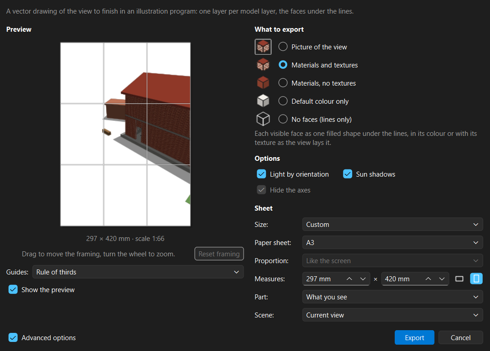

### Selection

Select something before opening the dialog, then choose **Part ▸
Selection**: only what is selected goes out, whole, framed on it as
Zoom Selection frames it — even when the screen shows only a part of it.
It works with every choice of *What to export*; for the picture of the
view, the rest of the model is hidden while the picture is taken and
shown again at once, outside the undo history. With nothing selected the
choice is greyed.

| The selection in the dialog | The SVG |
|---|---|
| 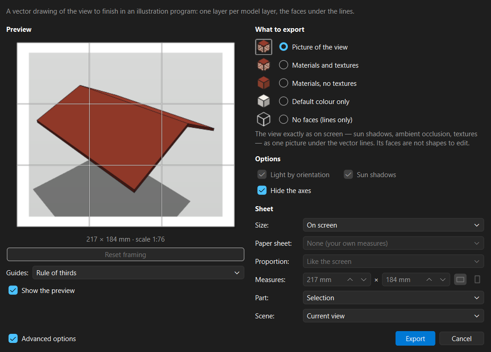 | 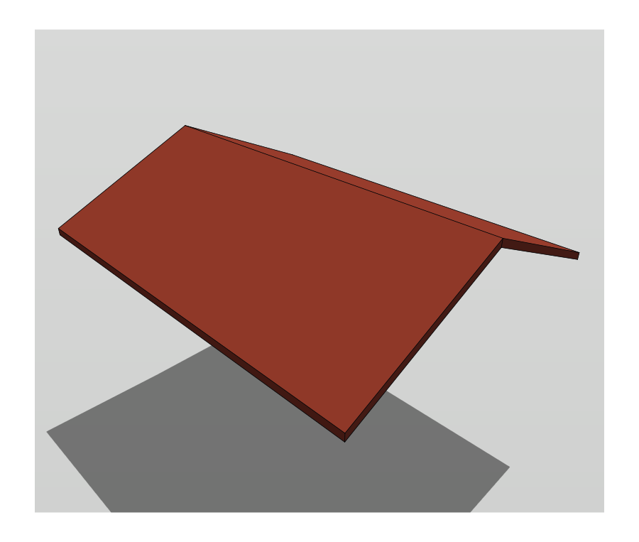 |

### Scenes

When the model has scenes, **Scene** exports one of them instead of the
view as it is — its camera, layers, style and shadows. The view shows the
scene while the dialog is open, so the preview is the scene's; on **Export**
or **Cancel** the view comes back as it was, and a document with nothing to
save still has nothing to save. The quick dialog and the advanced one share
the choice.

| The scene in the dialog | The SVG |
|---|---|
| 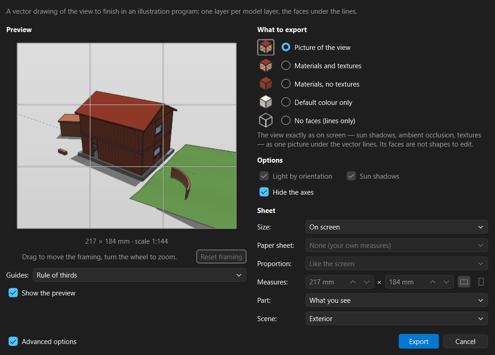 | 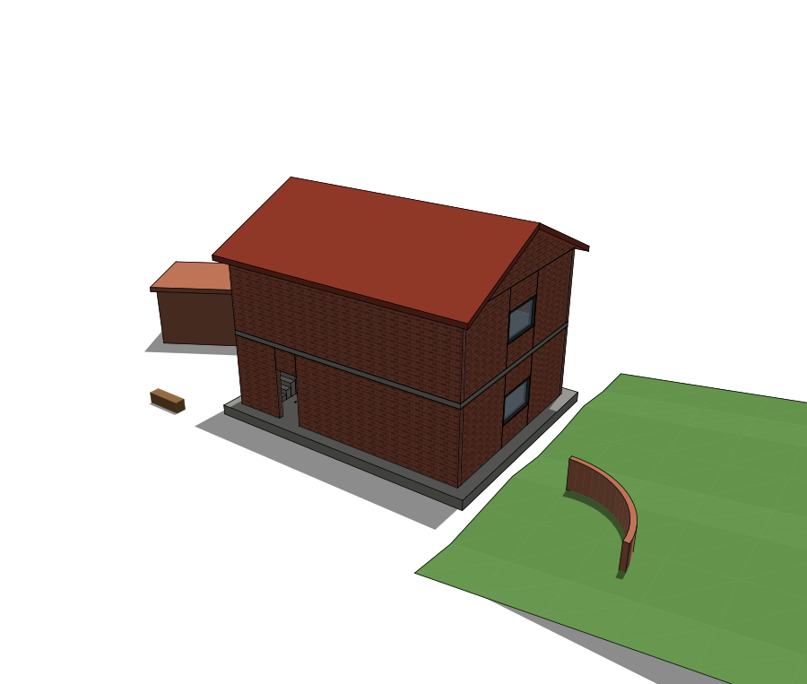 |

---

## 3. What the file holds

| Layer | Holds |
|---|---|
| *layer* (one per model layer) | The lines, with the layer's colour, line type and pen weight. In perspective all lines go on **VISTA**, as in the DXF export. |
| *layer*-CARAS | The faces of that layer, as filled shapes. |
| *layer*-CARAS-TRANSP | Its transparent faces, apart. |
| *layer*-SOMBRAS | The sun's shadows falling on that layer's faces. |
| SOMBRAS-SUELO | The shadows on the ground. |
| VISTA-IMAGEN | The picture of the view, with *Picture of the view*. |

Faces sit under the lines; each face is one shape, and ungrouping leaves
each line on its own — only lines that run on almost straight are joined.
Textures are baked into each face's own fill, so they look the same in any
program that opens the file.

| Picture of the view | Materials and textures |
|---|---|
|  | 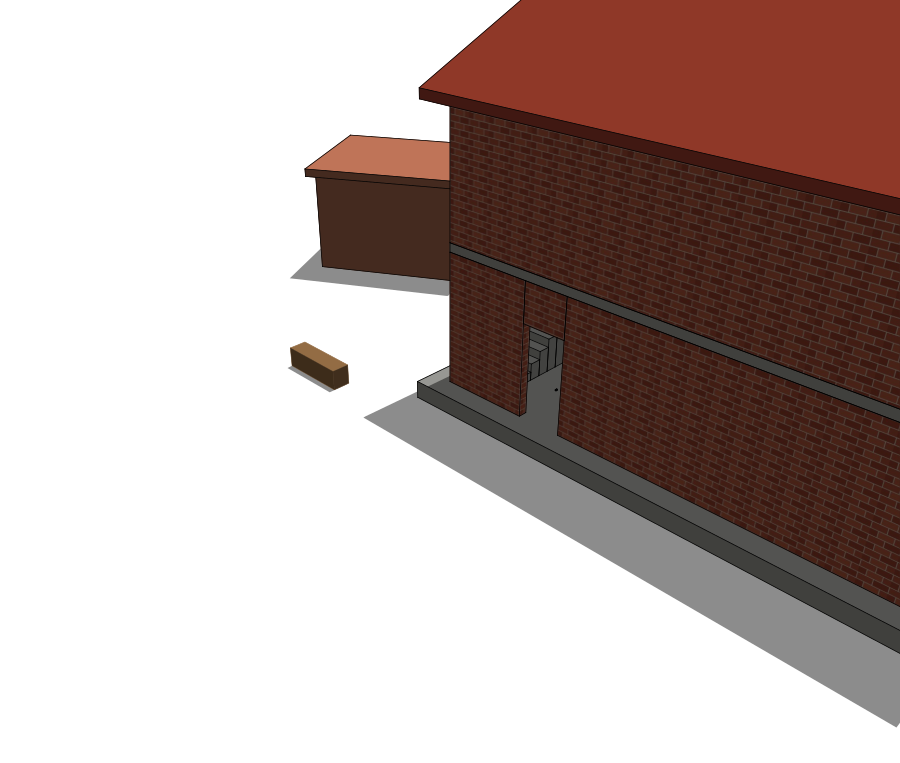 |

| Materials, no textures | Default colour only |
|---|---|
|  | 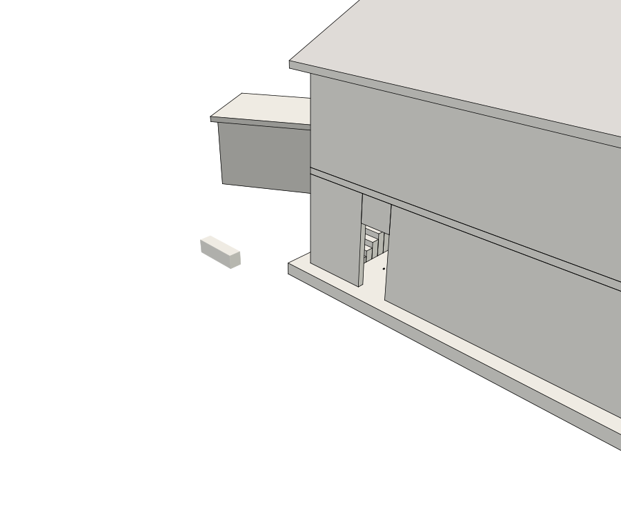 |
