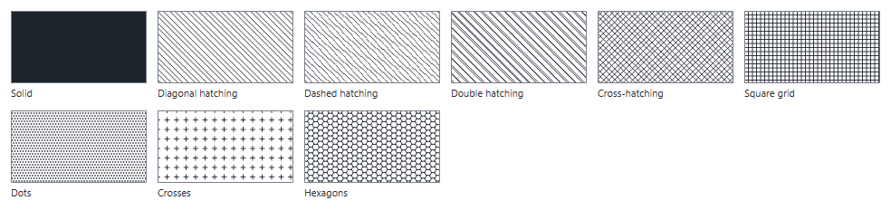
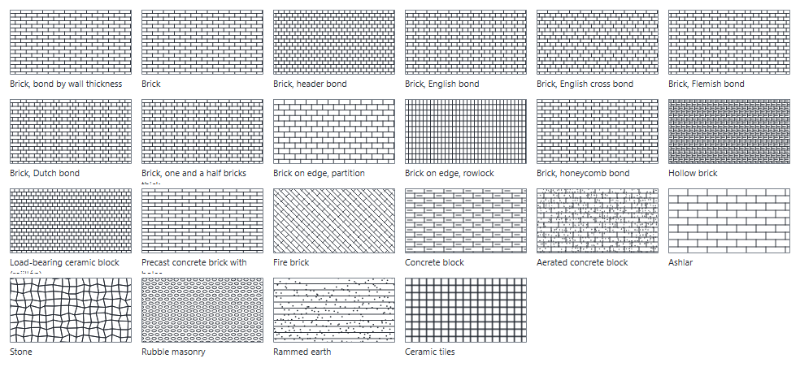
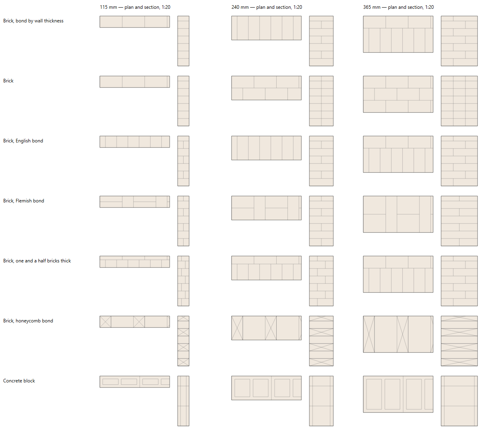
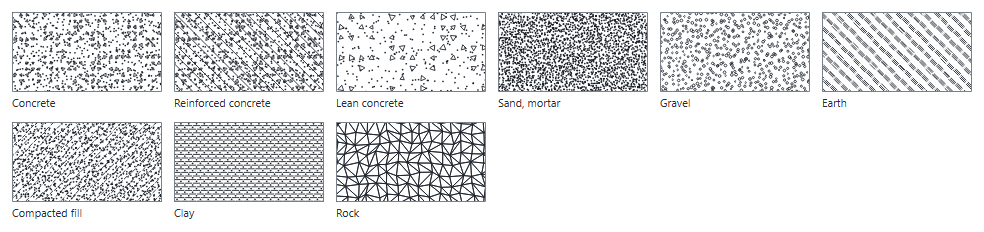
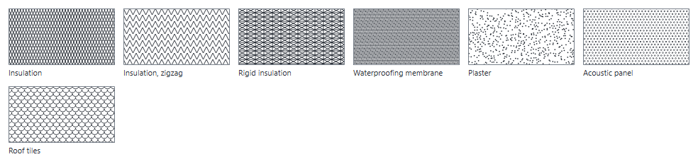
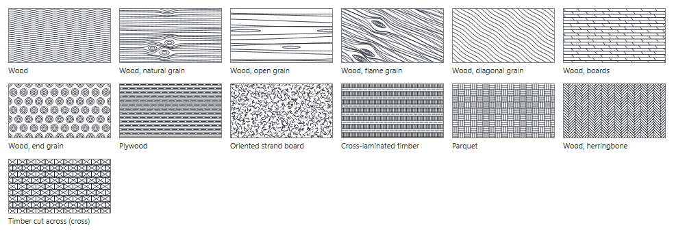
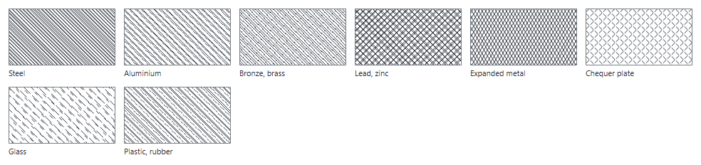
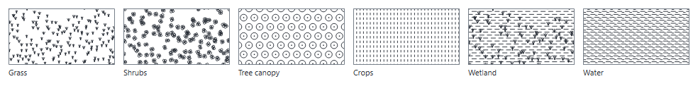
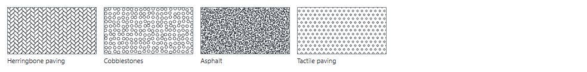

# Hatch patterns

The patterns a layer's section cut can be filled with on the sheets (see [Layers](layers.md), section 5). They follow the usual conventions of architectural and technical sections and are drawn from scratch. Every one can be turned, scaled, set on a ground colour and inked in a colour of its own; **Export .pat…** in the hatch picker writes the line patterns to a pattern file other drawing programs open.

*Density*: how dark the pattern reads. *Lines*: drawn only with lines, so it goes into a `.pat` file; the others (stipples, stones, rounds, waves) are generated. Suggested scale and angle are ×1 and 0° for every pattern: they are drawn at the size a 1:50–1:100 sheet needs.

## General

| Pattern | Code | Density | Lines | Use |
|---|---|---|---|---|
| Solid | `SOLID` | high | — | Thin cut elements, steel at small scale, poché |
| Diagonal hatching | `DIAG` | medium | yes | Any material, the generic section hatch |
| Dashed hatching | `DIAG-DASH` | low | yes | To demolish, provisional or projected parts |
| Double hatching | `DIAG-2` | medium | yes | A second generic material beside the first |
| Cross-hatching | `CROSS` | high | yes | Generic dense material, details |
| Square grid | `GRID` | medium | yes | Grid floors, square tiling, reference areas |
| Dots | `DOTS` | low | yes | Light fills, zones, soft materials |
| Crosses | `PLUS` | low | yes | Zoning: areas to keep, protected or reserved |
| Hexagons | `HEX` | low | yes | Hexagonal tiles, honeycomb panels, zoning |

## Masonry

Brickwork, block and dressed stone are drawn as they are built, whichever way the frame cuts them:

- **In a plan**, the top of a course, brick by brick along each wall: the head joints across it, the joints between its wythes along it.
- **In a vertical section across a wall**, the courses stacked, each split where its bricks meet — one brick of English bond shows a course of headers right through, then two stretchers side by side.
- **Cut along a wall** (a piece too wide to be one), and anywhere the cut is no wall, its face: the bond as it is seen on site.

The bricks fill each wall's thickness, and how many fit across it picks the bond of **Brick, bond by wall thickness**: thinner than a brick laid flat, brick on edge; half a brick, stretchers; one brick, English bond; one and a half, a stretcher on one face and a header on the other, swapped course by course. The other bonds keep their own and fit it to the wall.

**Joints**: automatic by the scale — a 45° hatch at 1:75 and smaller, single lines from 1:50 to 1:20, the joints at their real thickness (each brick its own outline) at 1:15 and larger — or fixed by the layer; **Mortar in the joints** fills them in light grey.

**Brick size**, in the hatch picker, sets the brick of the layer — one of the usual sizes or its own length, width, height and joint: the courses, the joints and the bricks across each wall follow it, at their real size at any scale.

| Pattern | Code | Density | Lines | Use |
|---|---|---|---|---|
| Brick, bond by wall thickness | `BRICK-AUTO` | medium | yes | Brick walls of any thickness: the bond follows each wall (partition, half brick, one, one and a half) |
| Brick | `BRICK` | medium | yes | Brick walls, stretcher bond |
| Brick, header bond | `BRICK-HD` | medium | yes | Load-bearing brick walls one brick thick, headers on the face |
| Brick, English bond | `BRICK-EN` | medium | yes | Brick walls, English bond (one brick thick) |
| Brick, English cross bond | `BRICK-X` | medium | yes | Load-bearing walls, English cross bond: the stretcher courses shift half a brick |
| Brick, Flemish bond | `BRICK-FL` | medium | yes | Brick walls and facings, Flemish (Gothic) bond, one brick thick |
| Brick, Dutch bond | `BRICK-NL` | medium | yes | Facings, Dutch bond: Flemish courses between header courses |
| Brick, one and a half bricks thick | `BRICK-1H` | medium | yes | Brick walls one and a half bricks thick |
| Brick on edge, partition | `BRICK-EDGE` | low | yes | Partitions of brick on edge, carrying only themselves |
| Brick on edge, rowlock | `BRICK-ROW` | medium | yes | Rowlocks: steps, sills, copings, lintels |
| Brick, honeycomb bond | `BRICK-HC` | low | yes | Honeycomb walls with gaps for air: screens, vents |
| Hollow brick | `BRICK-HOL` | medium | yes | Hollow or perforated brick partitions |
| Load-bearing ceramic block (rejillón) | `CERAMIC-LB` | medium | yes | Load-bearing ceramic blocks and perforated bricks (rejillón): holes running upright |
| Precast concrete brick with holes | `CONC-BRICK` | medium | yes | Precast concrete bricks with a few large holes running upright |
| Fire brick | `FIREBRICK` | medium | yes | Refractory linings: chimneys, ovens |
| Concrete block | `BLOCK` | medium | yes | Concrete block walls |
| Aerated concrete block | `AAC` | low | — | Aerated (cellular) concrete blocks: large, light, laid with a thin glued joint |
| Ashlar | `ASHLAR` | low | yes | Dressed stone walls in regular courses |
| Stone | `STONE` | medium | — | Stone walls, cladding |
| Rubble masonry | `RUBBLE` | medium | — | Rubble masonry, old walls, gabions |
| Rammed earth | `RAMMED` | low | — | Rammed earth and adobe walls |
| Ceramic tiles | `TILE` | medium | yes | Ceramic tiling, wall and floor finishes |

## Concrete and ground

| Pattern | Code | Density | Lines | Use |
|---|---|---|---|---|
| Concrete | `CONC` | medium | — | Plain concrete |
| Reinforced concrete | `CONC-R` | medium | — | Reinforced concrete: slabs, beams, columns |
| Lean concrete | `CONC-LEAN` | low | — | Blinding and lean concrete under foundations |
| Sand, mortar | `SAND` | high | — | Sand, mortar beds, screeds |
| Gravel | `GRAVEL` | medium | — | Gravel, hardcore, drainage layers |
| Earth | `EARTH` | medium | yes | Natural ground in section |
| Compacted fill | `FILL` | medium | — | Made ground, compacted fill |
| Clay | `CLAY` | medium | yes | Clay and silt layers in ground sections |
| Rock | `ROCK` | low | — | Bedrock and rock in ground sections |

## Insulation and finishes

| Pattern | Code | Density | Lines | Use |
|---|---|---|---|---|
| Insulation | `INSUL` | medium | — | Soft insulation: mineral wool, batts — fitted to the layer's thickness |
| Insulation, zigzag | `INSUL-ZZ` | low | — | Insulation in thin layers: boards, panels, cavities — one zigzag from face to face |
| Rigid insulation | `INSUL-R` | medium | yes | Rigid insulation boards: EPS, XPS, PIR |
| Waterproofing membrane | `WATERPROOF` | high | yes | Waterproofing and vapour membranes |
| Plaster | `PLASTER` | low | — | Plaster, render, gypsum board |
| Acoustic panel | `ACOUSTIC` | low | — | Acoustic and perforated panels |
| Roof tiles | `ROOF-TILE` | medium | — | Roof tiles in section or elevation |

## Wood

| Pattern | Code | Density | Lines | Use |
|---|---|---|---|---|
| Wood | `WOOD` | low | — | Timber along the grain |
| Wood, natural grain | `WOOD-GRAIN` | low | — | Natural timber seen along the grain, with its knots: boards, beams, cladding |
| Wood, open grain | `WOOD-OPEN` | low | — | Timber in elevation, light: a few long grain lines |
| Wood, flame grain | `WOOD-FLAME` | high | — | Flat-sawn boards: flame grain round the knots, veneers |
| Wood, diagonal grain | `WOOD-DIAG` | medium | — | Timber with the grain running across: cladding, battens |
| Wood, boards | `WOOD-BOARDS` | medium | — | Boarded floors and decks, timber cut lengthwise |
| Wood, end grain | `WOOD-END` | low | — | Timber cut across the grain |
| Plywood | `PLY` | medium | yes | Plywood and laminated boards |
| Oriented strand board | `OSB` | medium | — | Oriented strand board, chipboard |
| Cross-laminated timber | `CLT` | medium | yes | Cross-laminated timber panels |
| Parquet | `PARQUET` | medium | yes | Wooden floors, parquet in plan |
| Wood, herringbone | `WOOD-HERRING` | medium | — | Herringbone wooden floors: long narrow boards |
| Timber cut across (cross) | `WOOD-X` | low | — | Timber cut across its grain: studs, joists, beams, battens — a cross from corner to corner of each piece |

## Metals, glass and plastics

| Pattern | Code | Density | Lines | Use |
|---|---|---|---|---|
| Steel | `STEEL` | high | yes | Steel sections |
| Aluminium | `ALU` | medium | yes | Aluminium sections, frames |
| Bronze, brass | `BRONZE` | medium | yes | Bronze, brass, copper |
| Lead, zinc | `LEAD` | high | yes | Lead, zinc, flashings |
| Expanded metal | `MESH` | medium | yes | Expanded metal, gratings, meshes |
| Chequer plate | `CHEQUER` | medium | — | Chequer plate floors, stair treads |
| Glass | `GLASS` | low | yes | Glass in section |
| Plastic, rubber | `PLASTIC` | medium | yes | Plastics, rubber, seals |

## Vegetation and water

| Pattern | Code | Density | Lines | Use |
|---|---|---|---|---|
| Grass | `GRASS` | low | — | Lawn, grass areas |
| Shrubs | `SHRUB` | low | — | Shrub and hedge planting |
| Tree canopy | `TREES` | low | — | Tree groups, woodland in plan |
| Crops | `CROPS` | low | yes | Crops, planted beds, rows |
| Wetland | `WETLAND` | low | — | Marsh, wet meadow, rain gardens |
| Water | `WATER` | low | yes | Water: ponds, pools, rivers |

## Paving and urban

| Pattern | Code | Density | Lines | Use |
|---|---|---|---|---|
| Herringbone paving | `HERRING` | medium | — | Herringbone paving, brick or wood |
| Cobblestones | `COBBLE` | medium | — | Cobbled and setts paving |
| Asphalt | `ASPHALT` | high | — | Asphalt, roads, parking |
| Tactile paving | `TACTILE` | low | — | Tactile warning paving |
