# Layer

Bahasa Indonesia · [English](layers.md)

Layer mengatur isi model. Setiap objek, bidang, tepi, dimensi, teks, bidang
potong, garis bantu, dan gambar acuan memiliki layer. Dengan layer, Anda
menentukan **apa yang terlihat**, **apa yang bisa dipilih**, **tempat objek
baru diletakkan**, dan **tampilan hasil pada lembar serta DXF**.

Coba panduan ini dengan `examples/capas-prueba.igz`; lihat
[Dokumen contoh](#dokumen-contoh). Nama layer dalam dokumen contoh tetap
berbahasa Spanyol.

## 1. Tab Layer

Tab ini berada pada panel samping, di sebelah Penjelajah. Tombol pertama
pada bilah alat **Layer** juga membukanya.

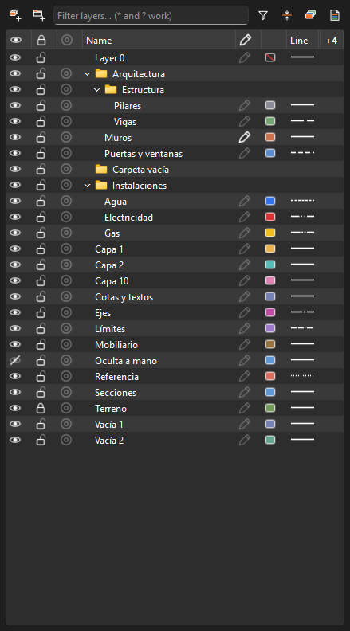

### Bilah atas

| Tombol | Fungsi |
|---|---|
| Tambah layer | Buat «Layer N» dengan nama yang siap diedit. Layer masuk ke folder terpilih atau folder yang memuat layer terpilih. |
| Tambah folder | Buat folder dengan cara serupa. Folder dapat bersarang. |
| Saringan nama | Saring berdasarkan nama. Wildcard seperti `*WALL*` dan `Layer ?` dapat dipakai. |
| Corong | Saring dengan sekali klik: semua, terlihat, tersembunyi, terkunci, tidak dicetak, terpakai, tak terpakai, atau layer dari pilihan. Tersedia juga **Balik saringan**. Ikon terisi saat saringan aktif. |
| Bentangkan / ciutkan semua | Buka atau tutup semua folder. |
| Warna per layer | Tampilkan model dengan warna tiap layer pada gaya Berbayang, Tekstur, dan Sinar-X. Scene menyimpan pengaturan ini bersama gayanya. |
| Templat layer dan opsi | Urutkan menurut nama atau waktu pembuatan; sembunyikan layer baru pada scene yang sudah ada; ekspor dan impor templat layer. |

### Kolom

| Kolom | Isi | Klik pada baris | Klik pada kepala kolom |
|---|---|---|---|
| Mata | Terlihat / tersembunyi | Tampilkan atau sembunyikan | Berlaku untuk semua layer |
| Gembok | Terkunci, ditampilkan pudar dan tidak bisa dipilih | Kunci / buka kunci | Berlaku untuk semua layer |
| Target | Isolasi | Tampilkan hanya layer itu, baris terpilih, atau layer dalam folder. Klik lagi untuk memulihkan yang disembunyikan | Akhiri isolasi |
| Nama | Nama dan folder | Klik dua kali / F2 untuk mengganti nama | Urutkan |
| Pensil | Layer aktif | Jadikan aktif | Urutkan |
| Warna | Contoh warna; Layer 0 tanpa warna ditandai garis miring merah | Pilih warna | Urutkan |
| Garis | Contoh jenis garis | Buka daftar jenis garis | Urutkan |
| mm | Tebal garis; «—» berarti bawaan dari lembar | Buka daftar ketebalan | Urutkan |
| % | Transparansi; «—» berarti tidak transparan | Buka daftar transparansi | Urutkan |
| Printer | Dicetak pada lembar atau tidak | Cetak / jangan cetak | Berlaku untuk semua layer |
| # | Jumlah entitas pada layer | — | Urutkan |

Mata, gembok, target, warna, garis, ketebalan, transparansi, dan printer
berlaku untuk **semua baris terpilih** jika baris yang diklik termasuk
pilihan. Klik ikon tersebut tidak mengubah pilihan baris. Dua klik cepat
pada mata menyembunyikan lalu menampilkan kembali layer.

### Memilih kolom

Tombol di ujung kepala tabel atau klik kanan pada kepala tabel membuka
daftar kolom. Tombol menampilkan «⋮» jika semua kolom terlihat, atau «+N»
jika N kolom tersembunyi. Menu tetap terbuka saat kotak dicentang agar
beberapa kolom bisa diubah sekaligus.

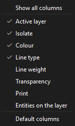

- Kolom bawaan: mata, gembok, target, nama, pensil, warna, dan garis.
  Kolom mm, printer, transparansi, serta # awalnya tersembunyi.
- **Tampilkan semua kolom** berada di atas; **Kolom bawaan** di bawah.
- Pilihan kolom diingat oleh aplikasi.

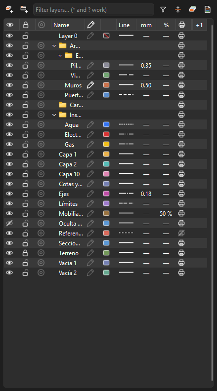

### Urutan

Layer 0 selalu pertama, disusul folder, lalu layer. Pengurutan nama membaca
angka secara numerik: «Layer 2» sebelum «Layer 10». Anda juga bisa memakai
urutan pembuatan melalui **Templat layer dan opsi ▸ Urutkan menurut…**.

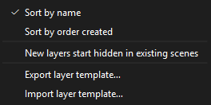

### Folder

- Folder dapat memuat layer dan folder lain.
- Mata, gembok, target, dan printer folder berlaku untuk semua layer di dalamnya.
- Seret satu atau beberapa layer maupun folder ke folder tujuan. Item yang
  diseret tampak transparan, folder tujuan diberi garis tepi, dan catatan
  bawah menunjukkan tujuannya, misalnya «Ke «Estructura»» atau «Keluar dari
  folder». Tahan penunjuk di atas folder tertutup untuk membukanya.
- Menghapus folder tidak menghapus layer di dalamnya; layer naik satu tingkat.

### Saringan

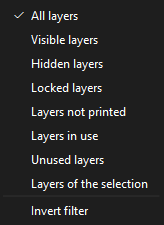

### Menu klik kanan

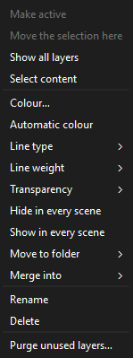

Perintah yang tersedia: Jadikan aktif, Pindahkan pilihan ke sini, Tampilkan
semua layer, Pilih isi, Warna / Warna otomatis, Jenis garis, Tebal garis,
Transparansi, Sembunyikan / Tampilkan di semua scene, Pindah ke folder,
Gabungkan ke, Ganti nama, Hapus, dan Bersihkan layer tak terpakai…

### Tombol keyboard

- **Delete** atau Backspace pada baris menghapus layer; Ctrl+Z memulihkannya.
- **F2** atau klik dua kali mengganti nama.

## 2. Layer aktif

Layer dengan ikon **pensil terisi** adalah layer aktif. Grup, komponen,
dimensi, teks, dan garis bantu baru ditempatkan pada layer tersebut.

**Garis dan bidang lepas tetap berada pada Layer 0**, sehingga
menyembunyikan layer tidak menyembunyikan hanya sebagian solid. Untuk
menggambar pada layer tertentu, gambar geometrinya lalu **buat grup**.
Grup masuk ke layer aktif.

Menyembunyikan atau mengunci layer aktif mengembalikan tujuan objek baru ke
Layer 0 agar objek tidak langsung dibuat dalam keadaan tersembunyi.

Jika tidak ada layer aktif, garis bantu, dimensi, dan teks memiliki layer
khusus: **Garis bantu**, **Dimensi**, dan **Teks**, sesuai bahasa antarmuka.
Layer dibuat saat entitas pertama digambar, sehingga semua garis bantu,
dimensi, atau teks bisa disembunyikan dengan satu klik mata. Jika layer
khusus itu tersembunyi atau terkunci, entitas baru ditempatkan pada Layer 0
agar tetap terlihat. Grup dan geometri lepas tidak terpengaruh.

## 3. Menampilkan, mengunci, dan mengisolasi

- **Sembunyikan** memakai ikon mata; **Kunci** memakai gembok. Layer terkunci
  ditampilkan pudar dan tidak dapat dipilih. Garis bantu pada layer
  tersembunyi tidak terlihat dan tidak menjadi acuan snap. Pada layer
  terkunci, garis bantu tetap terlihat dan menjadi acuan snap, tetapi
  tidak dapat dipilih atau dihapus.
- **Isolasi** memakai target. Hanya layer itu dan Layer 0 yang ditampilkan,
  karena Layer 0 memuat geometri di dalam objek. Memindahkan isolasi ke
  layer lain lalu mengakhirinya memulihkan semua yang disembunyikan oleh
  isolasi. Layer yang disembunyikan secara manual tetap tersembunyi.
- **Keadaan sebelumnya** pada bilah alat Layer membatalkan perubahan
  terakhir pada visibilitas, kunci, atau layer aktif tanpa mengubah gambar.

## 4. Warna dan transparansi

- Tiap layer memiliki warna otomatis atau warna pilihan. Layer 0 tidak
  memiliki warna sendiri, ditandai **garis miring merah**.
- **Warna per layer** menampilkan model dengan warna tersebut.
- **Transparansi** (0, 25, 50, 75%) membuat bidang pada layer tembus pandang.
  Pengaturan ini hanya mengubah tampilan model di layar.

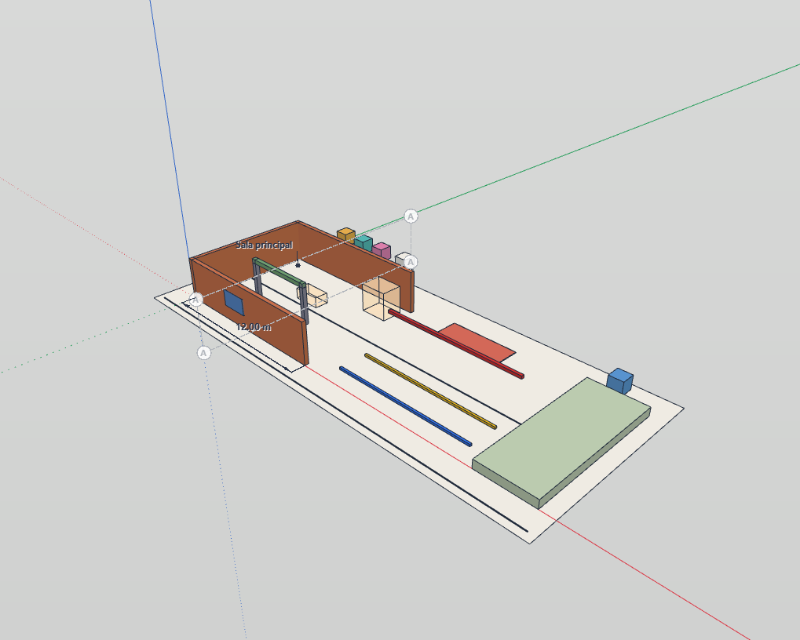

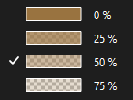

## 5. Jenis dan ketebalan garis

Pengaturan ini menentukan tampilan garis **pada lembar dan DXF**.

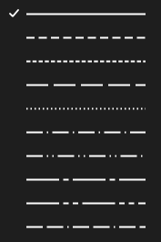

| Jenis | Penggunaan umum | Nama DXF |
|---|---|---|
| Menerus | Garis biasa | CONTINUOUS |
| Putus-putus | Bagian di atas / proyeksi | DASHED |
| Putus pendek (tersembunyi) | Garis tersembunyi | HIDDEN |
| Putus panjang | Bagian yang dibangun/dibongkar, instalasi | DASHEDX2 |
| Bertitik | Acuan | DOT |
| Garis-titik | Sumbu sekunder | DASHDOT |
| Garis-titik-titik | Pembagian | DIVIDE |
| Garis sumbu (putus panjang, titik) | Sumbu dan garis pusat | CENTER |
| Bayangan (putus panjang, dua titik) | Batas dan posisi alternatif | PHANTOM |
| Batas (dua putus, titik) | Garis batas | BORDER |

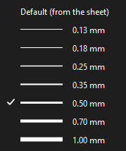

**Bawaan (dari lembar)** memakai pena bingkai: potongan 0,50 mm, profil
0,35 mm, dan tepi 0,18 mm. Ketebalan tetap dari 0,13 sampai 1,00 mm
menggantikan pena profil dan tepi. Pena potongan tetap memakai
ketebalannya sendiri.

## 6. Bilah alat Layer

| Elemen | Fungsi |
|---|---|
| Panel layer | Buka tab Layer. |
| Daftar pilihan | Tanpa pilihan objek: tampilkan dan tentukan layer aktif. Jika ada pilihan: tampilkan layer objek tersebut, atau «(beberapa)» jika berbeda. Memilih layer lain memindahkan objek ke sana sebagai satu langkah Urungkan. Setiap baris memiliki mata, gembok, dan target; titik menandai layer objek terpilih. |
| Jadikan layer aktif | Jadikan layer objek terpilih sebagai layer aktif. |
| Isolasi layer | Tampilkan hanya layer objek terpilih. |
| Kunci layer | Kunci layer objek terpilih. |
| Pindahkan ke layer aktif | Pindahkan pilihan ke layer aktif. |
| Sembunyikan layer | Sembunyikan layer objek terpilih. |
| Tampilkan semua layer | Tampilkan semuanya. |
| Keadaan sebelumnya | Pulihkan keadaan seperti dijelaskan di atas. |

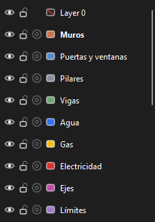

Tombol ini berguna saat Anda tidak mengetahui nama layer: pilih objek,
lalu klik tombolnya. Semua perintah tersedia dalam **Preferensi ▸ Pintasan
keyboard**, tanpa pintasan bawaan, dan pencarian perintah **F3**.

## 7. Dari area model

- **Klik kanan ▸ Layer** memindahkan pilihan ke layer lain, serta menyediakan
  **Sembunyikan layer ini**, **Isolasi layer ini**, dan **Jadikan layer ini aktif**.
- Memilih objek menyorot layernya pada panel dengan warna latar dan garis,
  serta memberi titik pada daftar pilihan. Folder tertutup yang memuatnya
  juga ditandai.
- **Info entitas ▸ Layer** juga berlaku untuk garis bantu dan gambar acuan.
- Saat kembali ke area gambar, pilihan baris pada panel dilepas.

## 8. Bidang potong, garis bantu, dan gambar acuan

- Bidang potong dapat ditempatkan pada layer. Menyembunyikan layer turut
  menyembunyikan bidang **beserta potongannya**.
- Garis bantu dari Pita Ukur dan Busur derajat berada pada layer seperti
  dimensi. Tanpa layer aktif, garis bantu baru masuk ke **Garis bantu**;
  lihat [Layer aktif](#2-layer-aktif). Layer tersembunyi tidak ditampilkan,
  tidak menjadi acuan snap, dan tidak bisa dipilih. Layer terkunci tetap
  terlihat dan menjadi acuan snap, tetapi tidak bisa dipilih atau dihapus.
  Garis bantu tidak pernah dicetak, sehingga layer ini dibuat dengan
  pengaturan **tidak dicetak** dan tidak muncul pada legenda layer lembar.
- Gambar acuan awalnya berada pada layer **Gambar**. Pindahkan melalui
  Info entitas, klik kanan ▸ Layer, atau **Pindahkan pilihan ke sini**.
- **Pilih isi** juga memilih garis bantu dan gambar pada layer.

## 9. Scene

- Setiap scene menyimpan layer yang terlihat.
- **Templat layer dan opsi ▸ Layer baru disembunyikan pada scene yang sudah
  ada** mencegah layer baru muncul pada denah yang telah disiapkan.
- Menu klik kanan menyediakan **Sembunyikan / Tampilkan di semua scene**.

## 10. Lembar

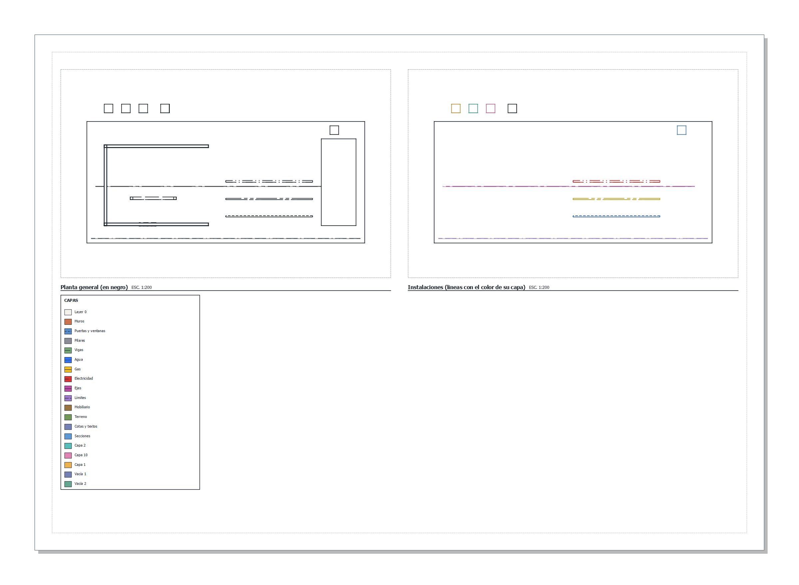

- Garis tiap layer mengikuti **jenis** dan **ketebalannya**.
- Warna bawaan hitam. Untuk denah instalasi atau zonasi berwarna, buka
  properti bingkai dengan gaya vektor, lalu pilih **Garis dengan warna
  layernya**. Bidang tetap memakai materialnya.
- **Tidak dicetak**, ditandai printer dicoret, berarti layer terlihat pada
  model tetapi tidak muncul pada lembar, PDF, atau DXF, sekalipun scene
  menampilkannya. Gunakan untuk acuan, garis konstruksi, dan catatan.
- **Legenda layer** memuat layer yang terlihat dan dicetak, lengkap dengan
  warna serta jenis garisnya.

Pada contoh, bingkai kiri menampilkan denah hitam tanpa furnitur yang
disembunyikan dalam scene dan tanpa garis acuan yang tidak dicetak.
Bingkai kanan menampilkan instalasi dengan warna per layer.

## 11. DXF

- **Ekspor tampilan sebagai DXF** pada penyusun lembar dan **Berkas ▸ Ekspor
  ▸ Tampilan saat ini sebagai DXF** pada proyeksi paralel membuat satu layer
  DXF per layer model, dengan warna, jenis garis, dan nama yang sama. Garis
  profil masuk ke `<layer>-PERFIL`, potongan ke `<view>-CORTE`, dan garis
  tersembunyi ke `<view>-OCULTAS`.
- Definisi jenis garis disimpan di dalam berkas.
- Layer 0 mengikuti warna bawaan program CAD.

## 12. Templat layer

**Templat layer dan opsi ▸ Ekspor templat layer…** menyimpan nama, warna,
jenis garis, ketebalan, transparansi, folder, dan pengaturan tidak dicetak
sebagai JSON. **Impor…** menerapkannya pada dokumen lain. Layer yang belum
ada ditambahkan; layer yang sudah ada mengikuti tampilan templat. Tidak ada
layer yang dihapus.

## 13. Menghapus, menggabungkan, dan membersihkan

- **Hapus**, melalui Delete atau menu klik kanan, memindahkan isi layer ke
  Layer 0. Jika layer memiliki isi, aplikasi meminta konfirmasi dan
  menampilkan jumlahnya. **Ctrl+Z memulihkan perubahan.**
- **Gabungkan ke** memindahkan semua isi ke layer tujuan dan menghapus
  layer asal. Tindakan ini juga dapat diurungkan.
- **Bersihkan layer tak terpakai…** menghapus layer kosong dan menampilkan
  jumlah yang dihapus.

Membuat dan mengganti nama layer tidak masuk riwayat Urungkan. Ctrl+Z
setelah menggambar membatalkan gambar, bukan nama yang diketik setelahnya.

## 14. Data yang disimpan dalam berkas

Berkas menyimpan warna, jenis garis, ketebalan, transparansi, pengaturan
tidak dicetak, visibilitas, dan kunci layer; folder beserta susunannya;
layer aktif; layer tiap bidang potong, garis bantu, dimensi, teks, dan
gambar acuan; Warna per layer dalam gaya tiap scene; serta Garis dengan
warna layernya pada tiap bingkai lembar.

## Dokumen contoh

`examples/capas-prueba.igz`, yang dibuat oleh `examples/capas-prueba.py`, memuat:

| Layer | Fitur yang dapat dicoba |
|---|---|
| Muros (Arquitectura) | Layer aktif; ketebalan 0,50 mm |
| Puertas y ventanas | Garis putus-putus |
| Pilares, Vigas (Arquitectura ▸ Estructura) | Folder bersarang; Vigas memakai putus panjang |
| Agua, Gas, Electricidad (Instalaciones) | Garis tersembunyi, bayangan, garis-titik-titik, dan warna |
| Ejes · Límites | Garis sumbu dan garis batas |
| Mobiliario | Transparansi 50%; tersembunyi pada «Planta general» |
| Referencia | Tidak dicetak; bertitik |
| Terreno | Terkunci |
| Oculta a mano | Disembunyikan |
| Cotas y textos · Secciones | Dimensi dan teks; bidang «Corte A» |
| Guías | Garis bantu pada sumbu A dan titik bantu; tidak dicetak |
| Capa 1, Capa 2, Capa 10 | Urutan numerik alami |
| Vacía 1, Vacía 2, Carpeta vacía | Pembersihan dan saringan layer tak terpakai |

Scene contoh: «Planta general», «Solo instalaciones», dan «Vista 3D».
Lembar «Lámina de capas» berisi dua bingkai dan legenda.
