# Layers

Layers organise the model. Every object, face, edge, dimension, text,
section plane, guide and reference image carries a layer, and with it you
decide **what is seen**, **what can be touched**, **where new things go**
and **how they come out on the sheets and in DXF**.

How the cut of each layer — its pen, its hatch, its masonry — and its line
types come out on the sheets, in the DXF and in the 3D view is told step by
step, with pictures, in [Cut, hatches and line types](cut-and-hatches.md).

Everything in this manual can be tried with the example document
`examples/capas-prueba.igz` (see [Example document](#example-document)); its
layer names are in Spanish, like the other examples.

---

## 1. The Layers tab

It sits in the side tray, next to the Browser. The first button of the
**Layers** toolbar opens it too.

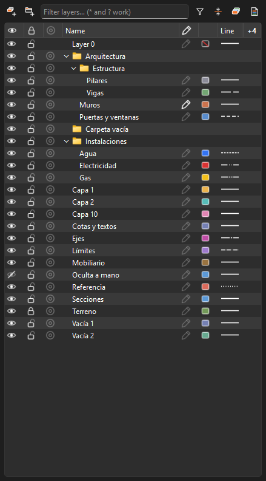

### Top bar

| Button | What it does |
|---|---|
| Add layer | Makes «Layer N» with its name open for typing. It goes into the selected folder, or into the folder of the selected layer. |
| Add folder | The same, for a folder (folders nest). |
| Filter | Filters by name; wildcards work: `*WALL*`, `Layer ?`. |
| Funnel | One-click filters: all, visible, hidden, locked, not printed, in use, unused, the selection's; and **Invert filter**. It fills in while a filter is on. |
| Expand / collapse all | Opens or closes every folder. |
| Colour by layer | Paints the model in each layer's colour (shaded, textured and X-ray styles). Scenes keep it with their style. |
| Templates and options | Sort by name or by order created; new layers hidden in existing scenes; export and import layer templates. |

### Columns

| Column | Shows | Click on a row | Click on the header |
|---|---|---|---|
| Eye | Visible / hidden | Shows or hides | Every layer |
| Padlock | Locked (drawn faded, out of reach) | Locks / unlocks | Every layer |
| Target | Isolate | Only that layer (or the selected rows, or the folder's layers). Again: back to what it hid | Ends the isolation |
| Name | Name and folders | Double-click / F2: rename | Sorts |
| Pencil | Active layer | Makes it active | Sorts |
| Colour | Swatch; Layer 0 without a colour: a red slash | Pick a colour | Sorts |
| Line | The line type, drawn | Line type list | Sorts |
| Hatch | The cut hatch, drawn; «—» = the frame's fill | Hatch grid | Sorts |
| mm | Line weight; «—» = default (from the sheet) | Weight list | Sorts |
| Cut | Cut weight; «—» = the sheet's cut pen | Weight list | Sorts |
| % | Transparency; «—» = opaque | Transparency list | Sorts |
| Printer | Whether it goes onto the sheets | Print / do not print | Every layer |
| # | Entities on the layer | — | Sorts |

Eye, padlock, target, colour, line, weight, cut, transparency and printer act on
**every selected row** when the clicked row is one of them. A click on them
never changes which rows are selected, and two quick clicks on an eye switch
the layer off and on again.

#### Choosing the columns

The button at the end of the header (or a right-click on the header) lists
the columns. It reads «⋮» when all show and «+N» when N are off. The menu
stays open while you tick, so several change in one go.

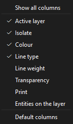

- **Default**: eye, padlock, target, name, pencil, colour and line.
  Mm, printer, transparency and # start off.
- **Show all columns** at the top; **Default columns** at the bottom.
- The choice is remembered.

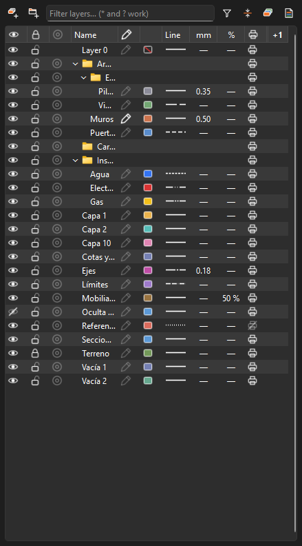

### Order

Layer 0 always first, then the folders, then the layers. By name, numbers
read as numbers («Layer 2» before «Layer 10»), or in the order they were
made (**Templates and options ▸ Sort by…**).

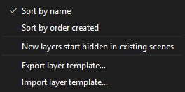

### Folders

- A folder groups layers and other folders.
- A folder's eye, padlock, target and printer act on all its layers.
- **Drag and drop** one or several layers (or folders) onto a folder. What is
  dragged shows see-through, the target folder is outlined and a note at
  the bottom says where it lands («Into «Estructura»», «Out of any folder»).
  A folded folder opens when you hold over it.
- Deleting a folder keeps its layers: they move up one level.

### Filters

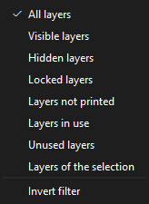

### Right-click menu

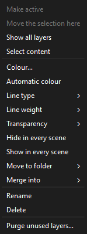

Make active · Move the selection here · Show all layers · Select content ·
Colour / Automatic colour · Line type · Line weight · Cut weight · Cut
hatch · Transparency · Hide /
show in every scene · Move to folder · Merge into · Rename · Delete · Purge
unused layers…

### Keyboard

- **Delete** (or Backspace) on a row: deletes the layer (Ctrl+Z brings it back).
- **F2** / double-click: rename.

---

## 2. Active layer

The layer with the filled **pencil** is the active one. What you create goes
onto it: **groups, components, dimensions, texts and guides**.

**Loose lines and faces stay on Layer 0**, so hiding a layer never leaves
half a solid. To draw «on» a layer, draw and **group**: the group goes onto
the active layer.

Hiding or locking the active layer hands back to Layer 0 (nothing is ever
drawn straight into hiding).

**With no layer active, guides, dimensions and texts have a layer of
their own:** a new guide goes onto **Guides**, a new dimension onto
**Dimensions** and a new text onto **Texts** (named in the interface
language), made the first time one is drawn. So the scaffolding, every
dimension or every text is switched off with one eye. If that layer is
hidden or locked, a new one stays on Layer 0, in sight. Groups and loose
geometry are not affected.

---

## 3. Show, lock and isolate

- **Hide** (eye) and **lock** (padlock). A locked layer is drawn faded and
  cannot be picked. A hidden layer's guides are not drawn and nothing snaps
  to them; a locked layer's guides still show and snap, but cannot be
  picked or erased.
- **Isolate** (target): only that layer, plus Layer 0, which holds the
  insides of every object. Moving the isolation to another layer and ending
  it brings back everything isolating hid; a layer hidden by hand stays
  hidden.
- **Previous state** (Layers toolbar): undoes the last change to visibility,
  lock or the active layer, without touching the drawing.

---

## 4. Colour and transparency

- Each layer has a colour (automatic or picked). Layer 0 has none of its
  own: a **red slash** says so.
- **Colour by layer** paints the model in those colours.
- **Transparency** (0, 25, 50, 75 %): the layer's faces are seen through.
  It only changes the model on screen.

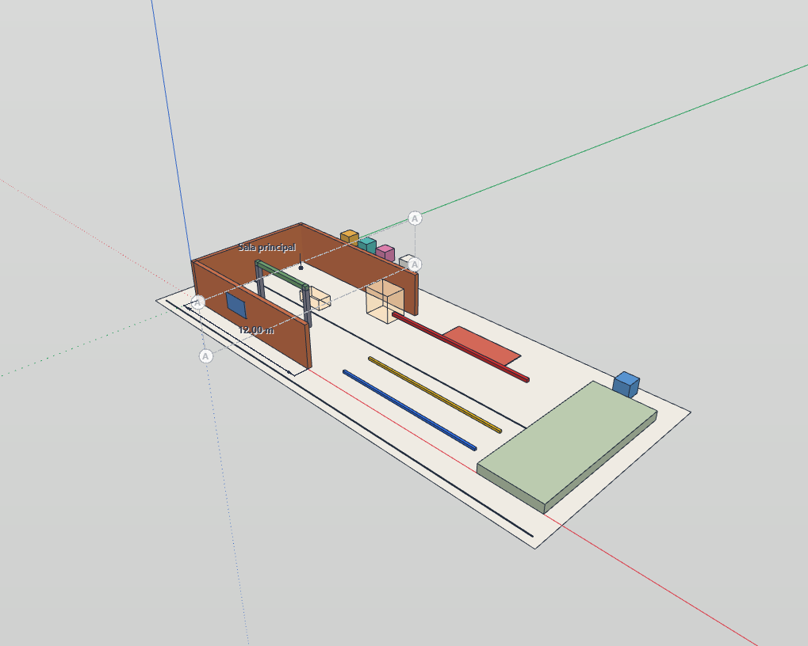

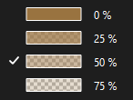

---

## 5. Line types and weights

They set how the layer's lines come out **on the sheets and in DXF**.

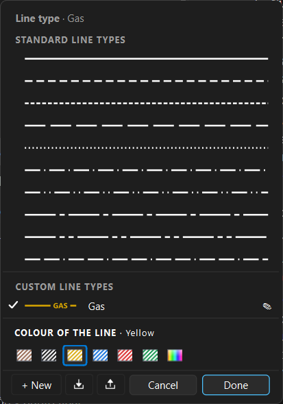

| Type | Usual use | DXF |
|---|---|---|
| Continuous | The normal line | CONTINUOUS |
| Dashed | Above / projected | DASHED |
| Short dashes (hidden) | Hidden lines | HIDDEN |
| Long dashes | To build / to demolish, services | DASHEDX2 |
| Dotted | References | DOT |
| Dash-dot | Secondary axes | DASHDOT |
| Dash-dot-dot | Divisions | DIVIDE |
| Centre line (long dash, dot) | Axes and centre lines | CENTER |
| Phantom (long dash, two dots) | Boundaries, alternate positions | PHANTOM |
| Border (two dashes, dot) | Borders | BORDER |

The **Line type** cell opens a small panel in the middle of the screen,
laid out as the hatch picker, the layer it works on named at the top:
the lines, then **Colour of the line** for the line type the layer has, then
**New**, import and export `.lin`, **Cancel** and **Done** at its foot. A click on a
line or a colour shows at once and the panel stays open; only **Done** (or
Enter on a line) keeps the change — Esc or a click outside put it back.

**Colour of the line**: by layer (the layer's colour, as before), black,
yellow, blue, red, green or any other — a gas line yellow, a water main
blue. The colour belongs to the line type, built-in or your own: every
layer drawn with it takes it, on the sheets and in the DXF.

**Line types in the model** (the Layers panel's options button, on unless a
style turns it off): the layers' line types on their edges in the 3D view
too — dashed as a sheet at 1:50 draws them, in the line type's colour. The
words of a line type (GAS…) stay on the sheets. The built-in line types' colours are kept in the
document.

**Line types of your own.** At the end of the list, under **Custom line
types**, are the document's own, each with a pencil to edit it — the
editor has **Delete line type** too; its layers go back to continuous.
**Import .lin** and **Export .lin** read and write the plain text line type
files drawing programs share.

The editor shows the line on a card at the top, drawn as you type: its
**name**, its **pieces** in paper mm — a dash `6`, a gap `-1.5`, a dot `0` —
typed or added with buttons, and a **Text in the line** with its height:
`GAS`, `AGUA`, `ELEC`… written along it in a gap of its own, upright
whichever way the line runs. Line type files with text inside
(`["GAS",STANDARD,S=…]`) are read with their text; only those with shapes
are left out, and the import says which. Your line types are kept in the
document, travel in the layer templates, print on the sheets (text and
all) and in the legend, and go to the DXF declared by their name — their
text as TEXT entities along the lines, since DXF R12 has no line type with
text.

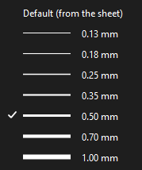

**Weight**: «Default (from the sheet)» uses the frame's pens (cut 0.50 ·
profiles 0.35 · edges 0.18 mm). A fixed weight (0.13 to 1.00 mm) replaces
the profile and edge pens; the cut keeps its own.

**Cut weight** (the **Cut** column, off by default, or right-click ▸ **Cut
weight**): the pen of the layer's section cut on the sheets. «The sheet's
cut pen» uses the frame's; a fixed one (0.13 to 1.00 mm) replaces it for
that layer only — walls cut at 0.70, doors and windows at 0.25. The cut stays
a continuous black line; the layer's own line type and weight do not touch
it.

**Cut hatch** (the **Hatch** column, or right-click ▸ **Cut hatch**): what the
layer's section cut is filled with on the sheets, so the materials read apart
on a technical section. A click opens a grid of the patterns, each drawn
with its name:

In the model the cut faces stay plain, unless the section plane asks for
them: right-click the plane in the Browser ▸ **Fill of this cut** ▸
**Layers' hatches** fills each layer's cut with its hatch, as a sheet at
1:50 draws it (bricks, blocks and joints at their real size). A layer
without a hatch keeps the plane's fill colour.

The patterns follow the usual conventions of architectural and technical
sections: 78 of them in 8 groups — general, masonry, concrete and ground,
insulation and finishes, wood, metals/glass/plastics, vegetation and water,
paving and urban. The [hatch catalogue](hatches.md) shows each one with its
use and density.

The patterns are in paper millimetres and stay put on the paper, so
neighbouring pieces continue the same pattern. Brickwork, block and ashlar
are drawn as they are built instead: in a plan, the top of a course brick
by brick along each wall, starting with a whole brick at its end (a
corner, a jamb); in a vertical section, the first course at the wall's
foot, the courses split where their bricks meet; **Brick, bond by wall
thickness** takes the bond each wall's thickness asks for (see the
[hatch catalogue](hatches.md#masonry)). The frame's **Hatch spacing**
makes every pattern larger or smaller (1.5 mm = their own size).

**Start X / Y** (under Angle and Scale, only for the patterns made of
pieces — brickwork, block, ashlar, stone, tiles, boards, parquet,
pavers) moves where the pieces start, in real millimetres: in a plan,
X moves the first joint along each wall; in a section, Y moves the first
course up; tiles and pavers move both ways, off an axis or a border.
The sheets, the DXF and the model's cut all follow it.

The lines of every hatch share one pen, set per frame: frame properties
(vector style) ▸ **Hatches** (Automatic: 70 % of the Edges pen) — the thin
line of the drawing, the same for every material.

Under the patterns, the same grid has two rows more:

- **Ground under the hatch** — a solid colour with the pattern on top: no
  ground (the paper), white, light grey, grey, the layer's colour (light) or
  any other colour.
- **Colour of the hatch** — the ink of the pattern's lines: **as the frame
  says** (its fill colour; the layer's colour when the frame fills by
  layer), **by layer** (always the layer's colour, and it follows when the
  layer's colour changes), black, dark grey or any other colour.

Without «Fill in each layer's colour», and with neither set, the patterns
are inked in the frame's fill colour on the paper; with it, in the layer's
colour over a pale ground of it. A layer's own ground and colour win over
both. The layer legend shows each layer's hatch with its ground and colour.

The picker opens centred on the screen, at the top of the list, and stays
open while you choose: every click shows at once, in the model and on the
sheets. Only **Done** (or Enter) keeps the changes; **Cancel**, Esc or a
click outside the picker put the layer back as it was when it opened. The arrow keys walk the patterns — left and right
through the list, up and down to the row above or below, across the groups
— each one applied as it is reached. At the top, a
search field and, beside it, a funnel to show one group at a time
(General, Masonry, Wood…; the search narrows within it); your
**Favourites** come first, then
the patterns you used last. The ☆ beside the name in the preview pins the
chosen pattern (★: pinned), and so does a right-click on any tile; they are
kept for every document.
The preview is one card: the pattern's name, its **Elevation** (the face)
and, for brickwork, block, stone and the patterns fitted to the piece (the
insulations, timber cut across), how it looks cut — **Plan**, a wall seen
from above, and **Section**, the same wall in a vertical section, side by
side at the same scale. Where every cut looks alike, the card says so.
Under the preview:

- **Angle** turns the pattern (steps of 15°) and **Scale** makes it larger
  or smaller (× 1: its own size).
- **Grows with the drawing scale** — materials that have a real size are
  drawn at it by themselves: a brick's course is 7.5 cm with its joint
  (7.5 mm on paper at 1:10, 1.5 mm at 1:50), a block 20 cm, a tile 30 cm, and so with ashlar,
  roof tiles, parquet, boards, pavers, cobbles and tactile paving. Stipples
  and generic hatches (concrete, sand, earth, diagonals…) keep their size on
  paper, the drawing convention. Ticking or unticking the box fixes either
  behaviour for the layer.
- **Cross where cut across the grain** — for the wood patterns: pieces cut
  across — studs, joists, beams in section — get a cross from corner to
  corner, and boards and beams cut along keep the wood pattern. The grain
  runs the way each piece is longest, read from the 3D piece: one that goes
  on further through the cut than within it is cut across (a stud in a
  plan, a joist in a section), one longer within it is cut along. Where the
  piece cannot be measured (an open surface), the cut's shape decides: up
  to 60 cm long and no more than six times as long as thick is across.
- **Piece size** — for brickwork, the hollow brick (ticholo), the
  load-bearing ceramic block (rejillón), the precast concrete brick, the
  concrete block and the aerated
  concrete block, each with its own usual sizes, listed by their measures:
  bricks (21.5 × 10.25 × 6.5, 25 × 12 × 5.5, 24 × 11.5 × 5, 29 × 14 × 7.1,
  26 × 12.5 × 5.5, 28 × 14 × 7), ticholos
  (12 and 8 × 17 × 25, the hollow bricks 12 and 18 × 18 × 33), load-bearing
  blocks (12 × 19 × 25, 18 × 19 × 33, the rejillón 12 × 10 × 25), precast
  concrete bricks with holes (12 × 6 × 25, 14 × 9 × 29), blocks
  (10, 15 and 20 × 19 × 39), aerated concrete (10 to 25 × 20 × 60, glued
  with a 3 mm joint). **Save this size** keeps measures of your own in the
  list of that kind of piece (marked ★), in every document; on one of them
  the button turns into **Remove from the list**. A
  drawing of the piece in isometric, its measures along its edges, sits
  under the preview. Or the
  layer's own length, width, height and joints: the **bed joint**
  (horizontal, under each course) and the **head joint** (vertical, between
  two bricks), with a padlock between them — closed, one measure typed in
  the bed joint; open, each its own. Courses, joints and the bricks across
  each wall follow it. **Use in the whole document** makes
  the brick shown the document's: every layer's brickwork takes it at once
  (chosen once) — one for each kind: a brick, a ticholo, a
  block — and a layer can still set its own afterwards.
  The document's brick travels in the layer templates.
- **Joints** — for brickwork, block and ashlar. **Automatic (by scale)**:
  a 45° hatch at 1:75 and smaller (bricks would blur), the joints as
  single lines from 1:50 to 1:20, the joints at their real thickness at
  1:15 and larger (a 1 cm joint is 1 mm at 1:10). Or fixed: **Single
  line**, **Double (real thickness)**, **None (outline only)**. **Mortar
  in the joints** fills the double joints in light grey.
- The picker is laid out side by side, in the order of the task: the
  catalogue on the left (search, groups, tiles), the preview and the
  settings of the chosen pattern on the right — wide and low, it fits a
  laptop screen.
- **No hatch** (the frame's fill) is the first tile of General.
- **Colour of the hatch**: **Automatic** (as the frame says), **The layer's
  colour**, or **Other colour…** (black, grey or any other).
- What is seldom set folds under **▸ More settings**, remembered for next
  time: the piece's fields —
  length, width, height, joints, the joint mode, the mortar, «Use in the
  whole document» — under the piece, whose list and measures (in one line)
  stay in sight. **Custom** opens them by itself.
- The settings come in sections — **Colour**, **Size and angle**, and
  only for the patterns that use them **Wood** (the cross) and **Piece**
  (its size and joints); the picker keeps its size whatever the pattern.
- **.pat files** (in the footer, beside Cancel and Done) holds Import and
  Export:
- **Export .pat…** writes the patterns drawn with lines (the built-in ones
  and the document's) to a pattern file other drawing programs open.
- **Import .pat…** brings in the patterns of a pattern file (`.pat`, the
  plain text format of technical drawing: families of lines with an angle,
  an origin, an offset and dashes). They show under **Imported**, travel
  with the document and can be picked for any layer.

---

## 6. The Layers toolbar

| Item | What it does |
|---|---|
| Layers panel | Opens the Layers tab. |
| Drop-down | With nothing selected: shows and sets the **active layer**. With something selected: shows **its** layer («(several)» when they differ) and picking another **moves it** (one undo step). Each row has an eye, a padlock and a target; a dot marks the selection's layers. |
| Make layer active | The layer of what is selected becomes the active one. |
| Isolate layer | Only the layer of what is selected. |
| Lock layer | Locks the layer of what is selected. |
| Move to active layer | Moves what is selected onto the active layer. |
| Hide layer | Hides the layer of what is selected. |
| Show all layers | Everything visible. |
| Previous state | See above. |

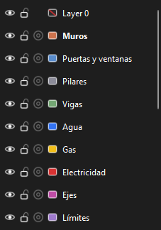

The buttons help when you do not know the layer's name: select the object
and click. All of them are in **Preferences ▸ Keyboard shortcuts** (no key
by default) and in the **F3** command search.

---

## 7. From the model

- **Right-click ▸ Layer**: move to a layer, plus **Hide this layer**,
  **Isolate this layer**, **Make this layer active**.
- Selecting something **highlights** its layer in the panel (a tint and a bar)
  and in the drop-down (a dot) — on a folded folder that holds it too.
- **Entity info ▸ Layer** works as before, now also for **guides** and
  **reference images**.
- Back in the drawing, the rows picked in the panel let go.

---

## 8. Section planes, guides and reference images

- A **section plane** can sit on a layer: hiding the layer hides the plane
  **and its cut**.
- A **guide** (Tape Measure, Protractor) sits on a layer like a dimension.
  With no layer active, new guides go onto **Guides** (see
  [Active layer](#2-active-layer)), so all the scaffolding goes with one
  eye. Hidden: not drawn, not snapped to, not picked. Locked: drawn and
  snapped to, but not picked or erased. Guides never print, so «Guides» is
  born **not printed** and stays out of the sheets' layer legend.
- A **reference image** starts on its own **Images** layer; Entity info,
  the right-click ▸ Layer and **Move the selection here** move it to any
  other.
- **Select content** of a layer picks its guides and images too.

---

## 9. Scenes

- Each scene remembers which layers show.
- **Templates and options ▸ New layers start hidden in existing scenes**: a
  layer made later does not turn up in plans already set up.
- Right-click ▸ **Hide / Show in every scene**.

---

## 10. Sheets

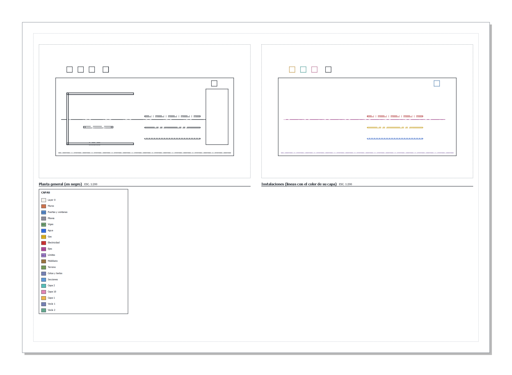

- Each layer's lines come out with their **type** and **weight**.
- **Black by default.** For a services or zoning plan in colour: frame
  properties (vector style) ▸ **Lines in their layer's colour** — the faces
  keep their material.
- **Section cut by layer**: each cut solid knows its layer — the layer of
  the face it cuts, else its object's. Its cut is inked with the layer's
  **cut weight** and filled with its **cut hatch** (brick, concrete,
  insulation…; see section 5). With frame properties (vector style) ▸
  **Fill in each layer's colour** each solid takes its layer's colour too;
  Layer 0 keeps the frame's **Fill colour**.
- **Not printed** (struck-through printer): the layer is seen in the model but
  left out of every sheet, its PDF and its DXF, even when the scene shows it.
  For references, construction lines and notes.
- **Layer legend**: lists the visible, printed layers with their colour and
  line.

In the example: the left frame is the plan in black (without the furniture,
hidden in that scene, nor the reference outline, which does not print); the
right one, the services with «Lines in their layer's colour».

---

## 11. DXF

- **Export view as DXF** (composer) and **File ▸ Export ▸ Current view as
  DXF** (parallel view): each model layer is a DXF layer with **its colour,
  line type and name**; its outlines go on `<layer>-PERFIL` and its cut on
  `<layer>-CORTE` (continuous). The hidden lines go on `<view>-OCULTAS`.
- Both also write each layer's **cut hatch** on `<layer>-TRAMA`, in its
  colour, as a sheet draws it — masonry brick by brick with its joints,
  insulation and timber fitted to each piece — as lines clipped to the cut
  (the file is DXF R12, which has no hatch entity). A **Solid** hatch, and
  the **ground** under a hatch on `<layer>-FONDO`, go out as filled SOLID
  strips under the lines. The composer's export draws them at its frame's
  scale; **Current view as DXF**, which has no sheet, at 1:50. Only the
  dots of stipples stay out.
- The line types are defined inside the file.
- Layer 0 keeps the CAD program's default colour.

---

## 12. Layer templates

**Templates and options ▸ Export layer template…** saves names, colours,
line types, weights, cut weights, cut hatches, transparency, folders and
«not printed» as JSON.
**Import…** brings them into another document: the missing layers are added,
the existing ones take the template's look, nothing is removed.

---

## 13. Delete, merge and purge

- **Delete** (Delete key or right-click): what the layer carried goes to
  Layer 0. With content, it asks first and says how much. **Ctrl+Z undoes
  it.**
- **Merge into**: everything on one layer moves to another and the first one
  goes (undoable too).
- **Purge unused layers…**: deletes the empty layers and says how many.

Making and renaming layers are not undo steps: Ctrl+Z after drawing takes
back the drawing, not a name typed in between.

---

## 14. What the file keeps

Layers with colour, line type, weight, cut weight, cut hatch, transparency,
«not printed»,
visibility and lock; folders and their nesting; the active layer; the
layer of each section plane, guide, dimension, text and reference image; «Colour by layer» in each scene's style; on each
sheet frame, «Lines in their layer's colour» and «Fill in each layer's
colour».

---

## Example document

`examples/capas-prueba.igz` (made by `examples/capas-prueba.py`) holds:

| Layer | To try |
|---|---|
| Muros (Arquitectura) | Active layer; weight 0.50 |
| Puertas y ventanas | Dashed |
| Pilares, Vigas (Arquitectura ▸ Estructura) | Nested folder; Vigas long dashes |
| Agua, Gas, Electricidad (Instalaciones) | Hidden, phantom, dash-dot-dot; colours |
| Ejes · Límites | Centre line · border |
| Mobiliario | 50 % transparent; hidden in «Planta general» |
| Referencia | Not printed; dotted |
| Terreno | Locked |
| Oculta a mano | Hidden |
| Cotas y textos · Secciones | A dimension and a text · the «Corte A» plane |
| Guías | A guide line along axis A and a guide point; not printed |
| Capa 1, Capa 2, Capa 10 | Natural order |
| Vacía 1, Vacía 2, Carpeta vacía | Purge and the «Unused» filter |

Scenes: «Planta general», «Solo instalaciones», «Vista 3D». Sheet: «Lámina
de capas» with two frames and the legend.
