# Layers

Layers organise the model. Every object, face, edge, dimension, text,
section plane, guide and reference image carries a layer, and with it you
decide **what is seen**, **what can be touched**, **where new things go**
and **how they come out on the sheets and in DXF**.

Everything in this manual can be tried with the example document
`examples/capas-prueba.igz` (see [Example document](#example-document)); its
layer names are in Spanish, like the other examples.

---

## 1. The Layers tab

It sits in the side tray, next to the Browser. The first button of the
**Layers** toolbar opens it too.

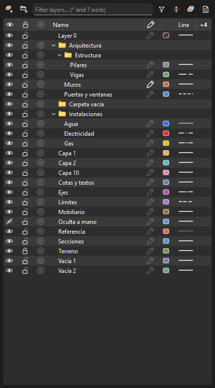

### Top bar

| Button | What it does |
|---|---|
| Add layer | Makes «Layer N» with its name open for typing. It goes into the selected folder, or into the folder of the selected layer. |
| Add folder | The same, for a folder (folders nest). |
| Filter | Filters by name; wildcards work: `*WALL*`, `Layer ?`. |
| Funnel | One-click filters: all, visible, hidden, locked, not printed, in use, unused, the selection's; and **Invert filter**. It fills in while a filter is on. |
| Expand / collapse all | Opens or closes every folder. |
| Colour by layer | Paints the model in each layer's colour (shaded, textured and X-ray styles). Scenes keep it with their style. |
| Templates and options | Sort by name or by order created; new layers hidden in existing scenes; export and import layer templates. |

### Columns

| Column | Shows | Click on a row | Click on the header |
|---|---|---|---|
| Eye | Visible / hidden | Shows or hides | Every layer |
| Padlock | Locked (drawn faded, out of reach) | Locks / unlocks | Every layer |
| Target | Isolate | Only that layer (or the selected rows, or the folder's layers). Again: back to what it hid | Ends the isolation |
| Name | Name and folders | Double-click / F2: rename | Sorts |
| Pencil | Active layer | Makes it active | Sorts |
| Colour | Swatch; Layer 0 without a colour: a red slash | Pick a colour | Sorts |
| Line | The line type, drawn | Line type list | Sorts |
| mm | Line weight; «—» = default (from the sheet) | Weight list | Sorts |
| % | Transparency; «—» = opaque | Transparency list | Sorts |
| Printer | Whether it goes onto the sheets | Print / do not print | Every layer |
| # | Entities on the layer | — | Sorts |

Eye, padlock, target, colour, line, weight, transparency and printer act on
**every selected row** when the clicked row is one of them. A click on them
never changes which rows are selected, and two quick clicks on an eye switch
the layer off and on again.

#### Choosing the columns

The button at the end of the header (or a right-click on the header) lists
the columns. It reads «⋮» when all show and «+N» when N are off. The menu
stays open while you tick, so several change in one go.

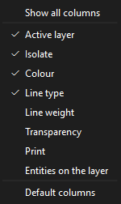

- **Default**: eye, padlock, target, name, pencil, colour and line.
  Mm, printer, transparency and # start off.
- **Show all columns** at the top; **Default columns** at the bottom.
- The choice is remembered.

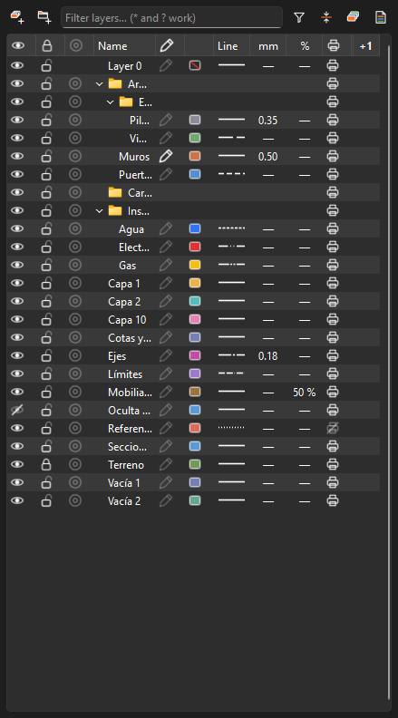

### Order

Layer 0 always first, then the folders, then the layers. By name, numbers
read as numbers («Layer 2» before «Layer 10»), or in the order they were
made (**Templates and options ▸ Sort by…**).

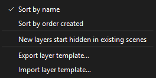

### Folders

- A folder groups layers and other folders.
- A folder's eye, padlock, target and printer act on all its layers.
- **Drag and drop** one or several layers (or folders) onto a folder. What is
  dragged shows see-through, the target folder is outlined and a note at
  the bottom says where it lands («Into «Estructura»», «Out of any folder»).
  A folded folder opens when you hold over it.
- Deleting a folder keeps its layers: they move up one level.

### Filters

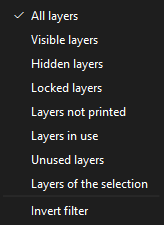

### Right-click menu

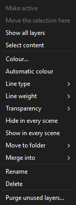

Make active · Move the selection here · Show all layers · Select content ·
Colour / Automatic colour · Line type · Line weight · Transparency · Hide /
show in every scene · Move to folder · Merge into · Rename · Delete · Purge
unused layers…

### Keyboard

- **Delete** (or Backspace) on a row: deletes the layer (Ctrl+Z brings it back).
- **F2** / double-click: rename.

---

## 2. Active layer

The layer with the filled **pencil** is the active one. What you create goes
onto it: **groups, components, dimensions, texts and guides**.

**Loose lines and faces stay on Layer 0**, so hiding a layer never leaves
half a solid. To draw «on» a layer, draw and **group**: the group goes onto
the active layer.

Hiding or locking the active layer hands back to Layer 0 (nothing is ever
drawn straight into hiding).

**With no layer active, guides, dimensions and texts have a layer of
their own:** a new guide goes onto **Guides**, a new dimension onto
**Dimensions** and a new text onto **Texts** (named in the interface
language), made the first time one is drawn. So the scaffolding, every
dimension or every text is switched off with one eye. If that layer is
hidden or locked, a new one stays on Layer 0, in sight. Groups and loose
geometry are not affected.

---

## 3. Show, lock and isolate

- **Hide** (eye) and **lock** (padlock). A locked layer is drawn faded and
  cannot be picked. A hidden layer's guides are not drawn and nothing snaps
  to them; a locked layer's guides still show and snap, but cannot be
  picked or erased.
- **Isolate** (target): only that layer, plus Layer 0, which holds the
  insides of every object. Moving the isolation to another layer and ending
  it brings back everything isolating hid; a layer hidden by hand stays
  hidden.
- **Previous state** (Layers toolbar): undoes the last change to visibility,
  lock or the active layer, without touching the drawing.

---

## 4. Colour and transparency

- Each layer has a colour (automatic or picked). Layer 0 has none of its
  own: a **red slash** says so.
- **Colour by layer** paints the model in those colours.
- **Transparency** (0, 25, 50, 75 %): the layer's faces are seen through.
  It only changes the model on screen.

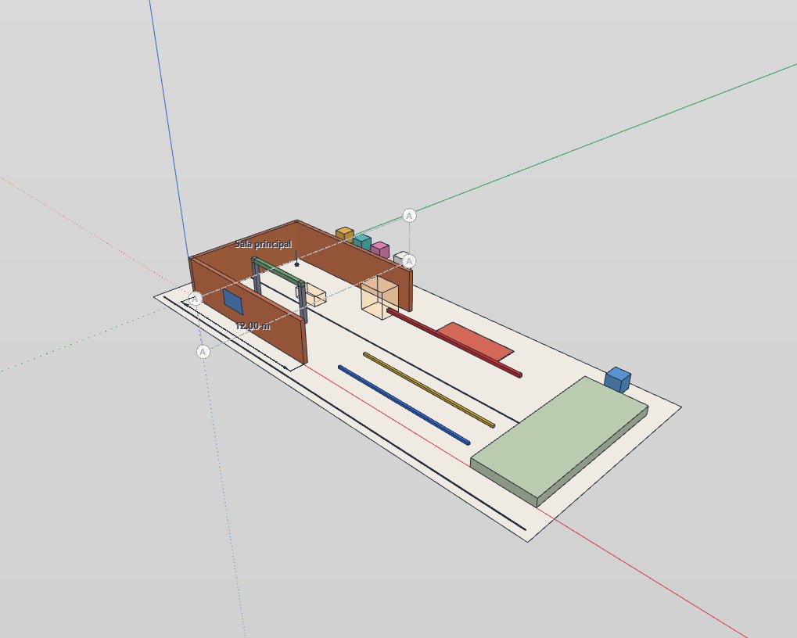

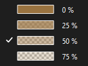

---

## 5. Line types and weights

They set how the layer's lines come out **on the sheets and in DXF**.

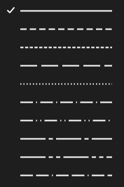

| Type | Usual use | DXF |
|---|---|---|
| Continuous | The normal line | CONTINUOUS |
| Dashed | Above / projected | DASHED |
| Short dashes (hidden) | Hidden lines | HIDDEN |
| Long dashes | To build / to demolish, services | DASHEDX2 |
| Dotted | References | DOT |
| Dash-dot | Secondary axes | DASHDOT |
| Dash-dot-dot | Divisions | DIVIDE |
| Centre line (long dash, dot) | Axes and centre lines | CENTER |
| Phantom (long dash, two dots) | Boundaries, alternate positions | PHANTOM |
| Border (two dashes, dot) | Borders | BORDER |

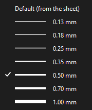

**Weight**: «Default (from the sheet)» uses the frame's pens (cut 0.50 ·
profiles 0.35 · edges 0.18 mm). A fixed weight (0.13 to 1.00 mm) replaces
the profile and edge pens; the cut keeps its own.

---

## 6. The Layers toolbar

| Item | What it does |
|---|---|
| Layers panel | Opens the Layers tab. |
| Drop-down | With nothing selected: shows and sets the **active layer**. With something selected: shows **its** layer («(several)» when they differ) and picking another **moves it** (one undo step). Each row has an eye, a padlock and a target; a dot marks the selection's layers. |
| Make layer active | The layer of what is selected becomes the active one. |
| Isolate layer | Only the layer of what is selected. |
| Lock layer | Locks the layer of what is selected. |
| Move to active layer | Moves what is selected onto the active layer. |
| Hide layer | Hides the layer of what is selected. |
| Show all layers | Everything visible. |
| Previous state | See above. |

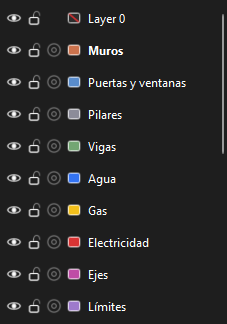

The buttons help when you do not know the layer's name: select the object
and click. All of them are in **Preferences ▸ Keyboard shortcuts** (no key
by default) and in the **F3** command search.

---

## 7. From the model

- **Right-click ▸ Layer**: move to a layer, plus **Hide this layer**,
  **Isolate this layer**, **Make this layer active**.
- Selecting something **highlights** its layer in the panel (a tint and a bar)
  and in the drop-down (a dot) — on a folded folder that holds it too.
- **Entity info ▸ Layer** works as before, now also for **guides** and
  **reference images**.
- Back in the drawing, the rows picked in the panel let go.

---

## 8. Section planes, guides and reference images

- A **section plane** can sit on a layer: hiding the layer hides the plane
  **and its cut**.
- A **guide** (Tape Measure, Protractor) sits on a layer like a dimension.
  With no layer active, new guides go onto **Guides** (see
  [Active layer](#2-active-layer)), so all the scaffolding goes with one
  eye. Hidden: not drawn, not snapped to, not picked. Locked: drawn and
  snapped to, but not picked or erased. Guides never print, so «Guides» is
  born **not printed** and stays out of the sheets' layer legend.
- A **reference image** starts on its own **Images** layer; Entity info,
  the right-click ▸ Layer and **Move the selection here** move it to any
  other.
- **Select content** of a layer picks its guides and images too.

---

## 9. Scenes

- Each scene remembers which layers show.
- **Templates and options ▸ New layers start hidden in existing scenes**: a
  layer made later does not turn up in plans already set up.
- Right-click ▸ **Hide / Show in every scene**.

---

## 10. Sheets

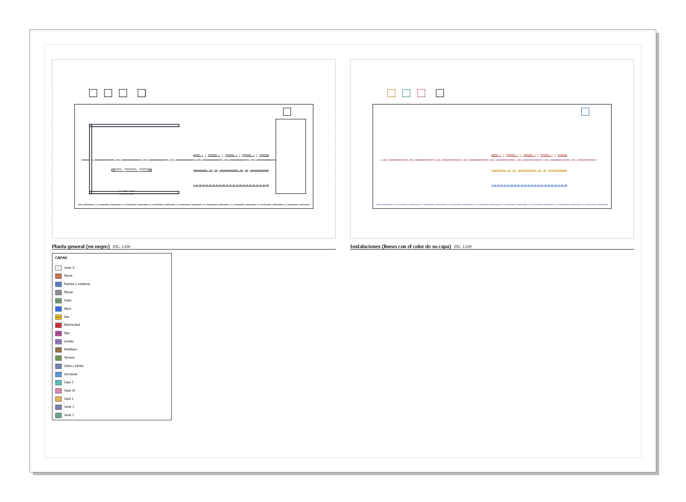

- Each layer's lines come out with their **type** and **weight**.
- **Black by default.** For a services or zoning plan in colour: frame
  properties (vector style) ▸ **Lines in their layer's colour** — the faces
  keep their material.
- **Not printed** (struck-through printer): the layer is seen in the model but
  left out of every sheet, its PDF and its DXF, even when the scene shows it.
  For references, construction lines and notes.
- **Layer legend**: lists the visible, printed layers with their colour and
  line.

In the example: the left frame is the plan in black (without the furniture,
hidden in that scene, nor the reference outline, which does not print); the
right one, the services with «Lines in their layer's colour».

---

## 11. DXF

- **Export view as DXF** (composer) and **File ▸ Export ▸ Current view as
  DXF** (parallel view): each model layer is a DXF layer with **its colour,
  line type and name**; its outlines go on `<layer>-PERFIL`. The cut and the
  hidden lines go on `<view>-CORTE` and `<view>-OCULTAS`.
- The line types are defined inside the file.
- Layer 0 keeps the CAD program's default colour.

---

## 12. Layer templates

**Templates and options ▸ Export layer template…** saves names, colours,
line types, weights, transparency, folders and «not printed» as JSON.
**Import…** brings them into another document: the missing layers are added,
the existing ones take the template's look, nothing is removed.

---

## 13. Delete, merge and purge

- **Delete** (Delete key or right-click): what the layer carried goes to
  Layer 0. With content, it asks first and says how much. **Ctrl+Z undoes
  it.**
- **Merge into**: everything on one layer moves to another and the first one
  goes (undoable too).
- **Purge unused layers…**: deletes the empty layers and says how many.

Making and renaming layers are not undo steps: Ctrl+Z after drawing takes
back the drawing, not a name typed in between.

---

## 14. What the file keeps

Layers with colour, line type, weight, transparency, «not printed»,
visibility and lock; folders and their nesting; the active layer; the
layer of each section plane, guide, dimension, text and reference image; «Colour by layer» in each scene's style; on each
sheet frame, «Lines in their layer's colour».

---

## Example document

`examples/capas-prueba.igz` (made by `examples/capas-prueba.py`) holds:

| Layer | To try |
|---|---|
| Muros (Arquitectura) | Active layer; weight 0.50 |
| Puertas y ventanas | Dashed |
| Pilares, Vigas (Arquitectura ▸ Estructura) | Nested folder; Vigas long dashes |
| Agua, Gas, Electricidad (Instalaciones) | Hidden, phantom, dash-dot-dot; colours |
| Ejes · Límites | Centre line · border |
| Mobiliario | 50 % transparent; hidden in «Planta general» |
| Referencia | Not printed; dotted |
| Terreno | Locked |
| Oculta a mano | Hidden |
| Cotas y textos · Secciones | A dimension and a text · the «Corte A» plane |
| Guías | A guide line along axis A and a guide point; not printed |
| Capa 1, Capa 2, Capa 10 | Natural order |
| Vacía 1, Vacía 2, Carpeta vacía | Purge and the «Unused» filter |

Scenes: «Planta general», «Solo instalaciones», «Vista 3D». Sheet: «Lámina
de capas» with two frames and the legend.
