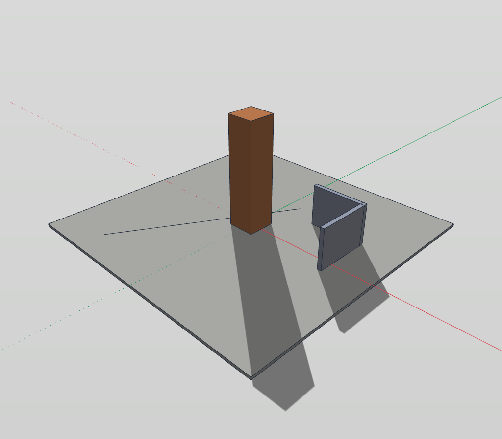
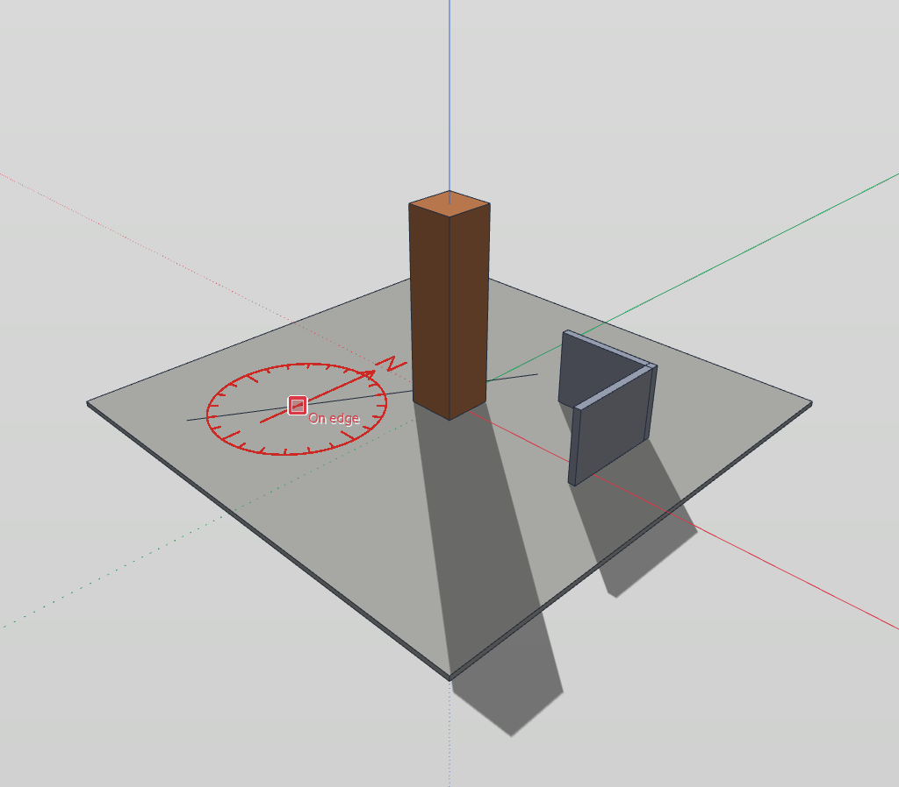
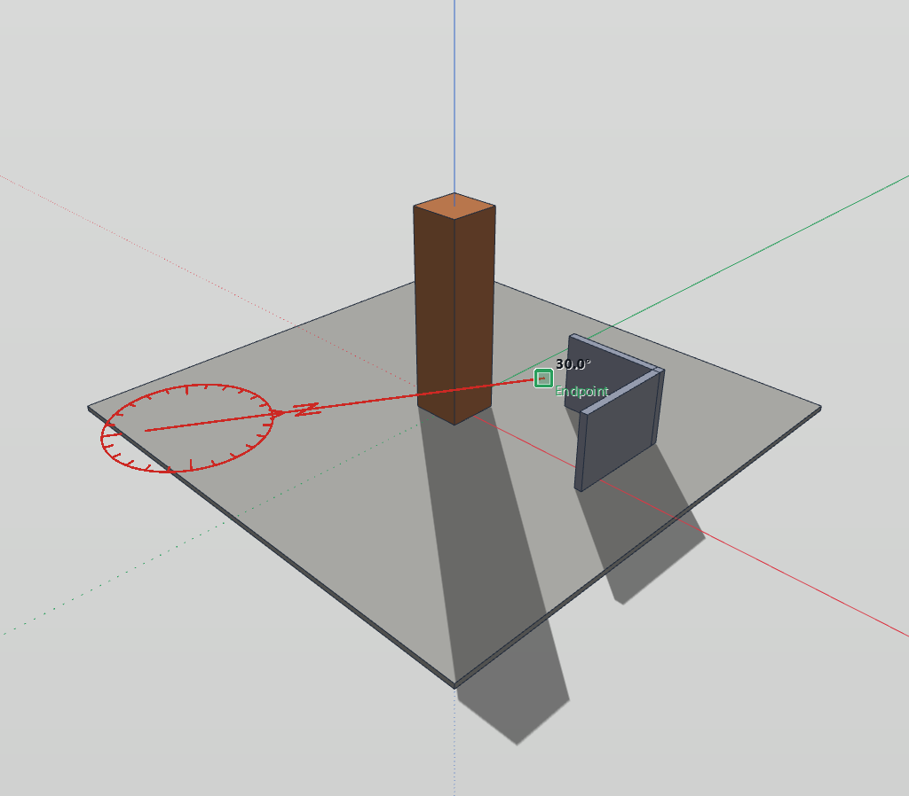
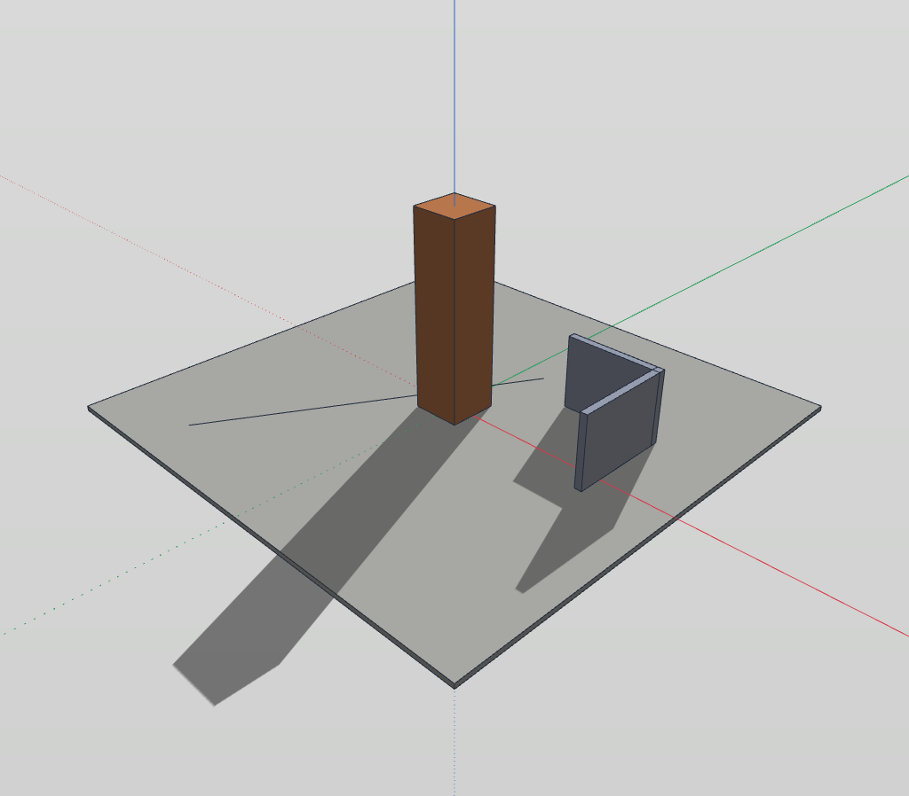
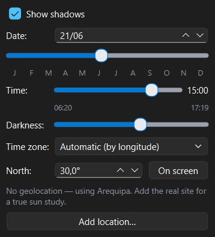

# North

A sun study only means something when the model knows where north is. The
**North** tool says it the natural way: by pointing at it on the model. A
compass rides the cursor, you click a centre and then click toward north,
and the shadows turn at once. The model itself never moves.

**Tools ▸ North** — **Shift+N** — also on the **Annotate** toolbar, and the
**On screen** button of the Shadows panel.

---

## 1. Before you start

North only shows in the shadows, so turn them on first: **Camera ▸ Shadows**,
or the Shadows button of the **Panels** toolbar. Pick a date and an
afternoon hour, so the shadows are long and easy to follow.

Until you set it, north is the **green (Y) axis**.

---

## 2. Aim north on screen

1. Press **Shift+N**. A red compass (a circle, an arrow and the letter
   **N**) follows the cursor. Its arrow shows where north lies **now**.

   

2. **Click** where you want the compass: its centre. The compass lies flat
   (in plan) at the height of that point.
3. Move the cursor: the arrow follows it, and the label reads the angle.
4. **Click toward north.** The shadows turn, and the status bar says
   «North: …°».

   

How precise the arrow is depends on where the cursor is:

| Cursor | The arrow |
|---|---|
| Near the compass | Snaps to the **15°** ticks. |
| Farther out | Free, at **0.1°**. |
| On an inference (an endpoint, an edge, an axis, a guide…) | Aims at it **exactly**. |

The last row is the useful one on a real site: draw the street or the
boundary the survey gives you, put the centre on one end and click the
other. North runs along it exactly.

**Esc** drops the centre without changing anything. The compass stays on
after a click, ready for another go.

---

## 3. Type the angle

With the tool active, type the degrees and press **Enter**. The centre is not
needed. The angle is **clockwise from the green axis**:

| Typed | North lies along |
|---|---|
| `0` | the green axis (+Y) |
| `90` | the red axis (+X) |
| `-90` | the negative red axis (−X) |
| `180` | the negative green axis (−Y) |

Angles wrap: `350` and `-10` are the same north.

---

## 4. The Shadows panel

The panel has a **North:** field with the same value. Type there and press
Enter; the shadows turn as they do with the tool. The **On screen** button
next to it picks up the tool.

---

## 5. With and without a location

| The model… | What North changes |
|---|---|
| has **no location** | Only the sun. The angle is kept in the document. The sun stands over the default site until you add the real one. |
| has a **location** | The location's own north angle, the **North** field of the **Terrain** tab (Base map). The base map and the terrain turn **under** the model; the model stays square to its axes. |

If you set north first and add the location later, the location keeps the
north you set: the shadows do not jump.

---

## 6. Undo, saving and scenes

- Each change of north is **one undo step** (Ctrl+Z / Ctrl+Y), from the
  tool, a typed angle or the Shadows panel.
- North is saved with the document. A file whose north was never set does not
  change at all.
- North belongs to the site, not to a view: **scenes do not change it**.
  Every scene shows the shadows with the same north.
- **File ▸ New** starts again with north along the green axis.
- The Blender render uses the same north, so its sun matches the viewport.
