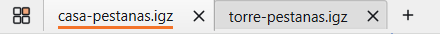
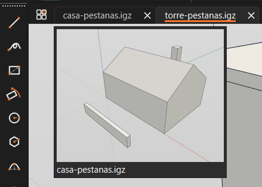
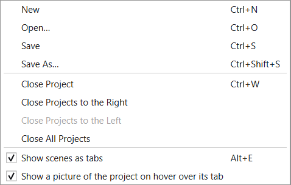
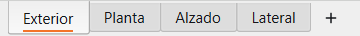
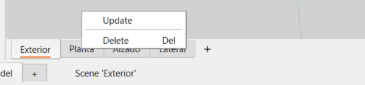
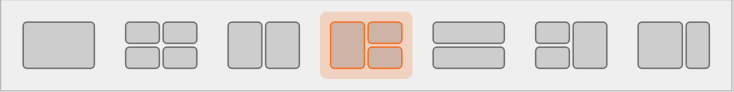
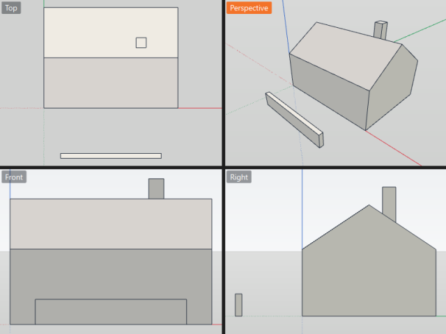
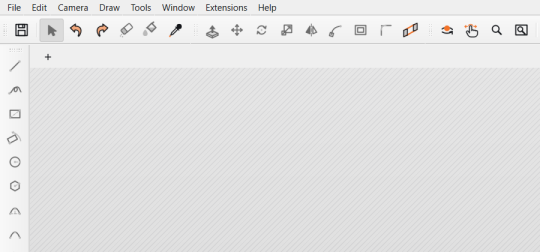

# Tab proyek, scene, dan tampilan

Bahasa Indonesia · [English](project-tabs.md)

Beberapa proyek dapat dibuka dalam satu jendela, masing-masing pada tab
tersendiri. Scene proyek juga muncul sebagai tab di bawah area model.
Tombol di kiri tab proyek menampilkan model dalam satu, dua, tiga, atau
empat tampilan sekaligus.

Coba panduan ini dengan `examples/pestanas-prueba.igz`, rumah dengan empat
scene yang dijelaskan pada bagian [Dokumen contoh](#dokumen-contoh).
Buka dokumen lain di sebelahnya untuk mencoba dua tab proyek.

## 1. Tab proyek

| Bagian | Fungsi |
|---|---|
| Tab | Mewakili satu proyek terbuka. Tab aktif ditandai garis warna aksen di bawah nama. Titik setelah nama menandakan perubahan belum disimpan. Seret untuk mengubah urutan; klik tengah untuk menutup. |
| × | Tutup proyek tersebut. Pertanyaan penyimpanan hanya berlaku untuk perubahan pada proyek itu. |
| **+** | Selalu buat proyek baru pada tab tersendiri. Klik dua kali area kosong di kanan tab memberikan hasil yang sama. |
| Empat kotak | Pilih susunan tampilan proyek aktif; lihat [Susunan tampilan](#3-susunan-tampilan). |

**Berkas ▸ Buka**, Buka Terbaru, klik dua kali berkas, dan perintah terminal
membuka dokumen pada tab baru. Jika dokumen sudah terbuka, tabnya diaktifkan.
**Berkas ▸ Baru** (Ctrl+N) memakai tab *Tanpa judul* yang belum diubah;
selain itu, perintah ini membuat tab baru.

### Pratinjau saat tab ditunjuk

Arahkan penunjuk ke tab proyek yang tidak aktif untuk melihat pratinjau
tampilannya beserta nama berkas, tanpa meninggalkan proyek aktif. Tab baru
atau tab yang belum pernah ditinggalkan hanya menampilkan tooltip.

Pratinjau dibuat saat tab pertama kali ditunjuk setelah Anda meninggalkannya,
sehingga proses membuka dan berpindah tab tidak perlu menunggunya. Pada model
besar, pratinjau pertama mungkin memerlukan waktu. Setelah itu, gambar langsung
muncul sampai Anda kembali ke proyek tersebut.

Untuk menonaktifkannya pada semua tab, hapus centang **Tampilkan gambar
proyek saat penunjuk berada di atas tabnya** melalui menu klik kanan tab
atau **Jendela ▸ Preferensi**. Tab hanya menampilkan tooltip lokasi berkas
dan tidak membuat gambar pratinjau.

### Menu klik kanan tab

Proyek yang diklik kanan diaktifkan terlebih dahulu, sehingga **Simpan**
dan **Simpan Sebagai** berlaku untuk proyek tersebut.

| Perintah | Fungsi |
|---|---|
| Baru, Buka…, Simpan, Simpan Sebagai… | Sama seperti dalam menu Berkas. |
| Tutup Proyek | Tutup proyek ini (Ctrl+W). |
| Tutup Proyek di Kanan / di Kiri | Tutup tab di sisi tersebut satu per satu. Setiap proyek menanyakan penyimpanan perubahannya sendiri; Batal menghentikan proses. Perintah dinonaktifkan jika tidak ada tab di sisi itu. |
| Tutup Semua Proyek | Tutup semuanya hingga tersisa [area kosong](#4-saat-semua-proyek-ditutup). |
| Tampilkan scene sebagai tab | Tampilkan atau sembunyikan baris scene proyek ini (Alt+E). |
| Tampilkan gambar proyek saat penunjuk berada di atas tabnya | Aktifkan atau nonaktifkan pratinjau pada semua tab. |

### Pintasan

| Tombol | Fungsi |
|---|---|
| Ctrl+W | Tutup proyek aktif |
| Ctrl+PgDown / Ctrl+PgUp | Proyek berikutnya / sebelumnya |
| Ctrl+Tab | Jika beberapa proyek terbuka: proyek berikutnya. Jika hanya satu: beralih ke lembar |
| Alt+E | Tampilkan atau sembunyikan baris scene proyek aktif |
| Alt+T | Tampilkan atau sembunyikan tab proyek |
| Ctrl+Space | Pada susunan beberapa tampilan: maksimalkan tampilan di bawah penunjuk, atau pulihkan susunannya |

### Menyembunyikan tab proyek

**Alt+T** atau **Jendela ▸ Tampilkan tab proyek** menyembunyikan seluruh
baris, termasuk **+** dan tombol empat kotak, agar area model lebih luas.
Pilihan ini diingat saat aplikasi dijalankan kembali. Proyek tetap terbuka:
Ctrl+PgDown dan Ctrl+PgUp berpindah antarproyek, sedangkan judul jendela
menunjukkan proyek aktif. Saat semua proyek ditutup, baris beserta **+**
muncul kembali agar Anda dapat membuka proyek dari area kosong.

## 2. Scene sebagai tab

Di bawah area model terdapat scene proyek aktif dalam urutan yang sama
seperti pada panel **Scene**.

| Tindakan | Hasil |
|---|---|
| Klik scene | Tampilkan scene dan tandai dengan garis warna aksen, seperti klik dua kali pada panel Scene. |
| Klik dua kali scene | Tampilkan scene, lalu minta nama baru. |
| Seret scene | Ubah urutan scene tanpa mengubah arah pandang. Ctrl+Z mengembalikan urutannya. |
| **+** setelah scene terakhir | Simpan tampilan saat ini sebagai scene baru. |
| Klik kanan scene | Buka menu tanpa mengubah tampilan. |
| Klik kanan area baris di luar tab | Tampilkan perintah **Sembunyikan scene**. |

| Perintah | Fungsi |
|---|---|
| Perbarui | Simpan tampilan saat ini ke scene tersebut. |
| Ganti nama… | Minta nama baru. Tampilan pada lembar yang memakai scene ini ikut berubah. Ctrl+Z mengembalikan nama lama. |
| Hapus | Hapus scene. Ctrl+Z memulihkannya. |

Kedua menu terbuka ke atas dari bagian bawah jendela.

Panel **Scene** menyediakan fungsi yang sama: menu klik kanannya berisi
**Ganti nama…**, **Naikkan**, dan **Turunkan**. Tombol **↑ ↓** di bawah
daftar (Alt+↑ / Alt+↓) memindahkan scene terpilih. Urutan pada panel dan
baris tab selalu sama; urutan itulah yang disimpan dalam dokumen.

Proyek tanpa scene tidak menampilkan baris ini. Membuat scene pertama
melalui **+ Scene** pada panel Scene memunculkannya, dan menghapus scene
terakhir menyembunyikannya. Setiap proyek menyimpan pilihan tampil/sembunyi
sendiri. Gunakan **Alt+E**, **Jendela ▸ Tampilkan scene sebagai tab**, menu
tab proyek, atau **Sembunyikan scene** pada baris. Jika dinonaktifkan, baris
tetap tersembunyi meskipun proyek memiliki scene.

## 3. Susunan tampilan

Tombol empat kotak di kiri tab proyek membuka pilihan susunan yang
digambarkan sesuai bentuk panelnya. Satu tampilan selalu berada di urutan
pertama, diikuti susunan yang paling sering dipakai.

| Susunan | Isi |
|---|---|
| Satu tampilan | Hanya tampilan 3D, seperti saat proyek dibuka. |
| Empat tampilan | Atas, Perspektif, Depan, dan Kanan. |
| Dua tampilan | Atas dan Perspektif berdampingan. |
| Tiga tampilan | Perspektif besar di kiri; Atas di atas Depan pada sisi kanan. |
| Dua tampilan, satu di atas yang lain | Perspektif di atas, Atas di bawah. |
| Tiga tampilan, yang besar di kanan | Atas di atas Depan pada sisi kiri; Perspektif besar di kanan. |
| Dua tampilan, satu lebih lebar | Perspektif lebar dan Atas sempit. |

- Setiap proyek mempertahankan susunan, kamera tiap tampilan, dan tampilan
  yang dimaksimalkan selama sesi. Proyek baru dimulai dengan satu tampilan
  3D. Mengganti susunan tidak menandai dokumen sebagai sudah diubah.
- **Simpan** menyimpan susunan dan posisi garis pembatas dalam berkas,
  seperti penyimpanan kamera. Berkas dibuka kembali dengan susunan tersebut.
  Kamera tampilan tambahan dan keadaan maksimalkan tidak disimpan.
- Nama tampilan muncul pada label kecil di sudutnya. Label tampilan aktif
  memakai warna aksen. Klik label untuk memilih Atas, Depan, Kanan,
  Belakang, Kiri, Bawah, Isometrik, atau Perspektif. Pilihan manual tetap
  berlaku saat susunan diubah.
- **Maksimalkan**, perintah pertama pada menu label, membuat satu tampilan
  memenuhi area. Perintah lalu berubah menjadi **Pulihkan** untuk
  mengembalikan tampilan lain. **Ctrl+Space** atau **Jendela ▸ Maksimalkan
  tampilan** melakukan hal yang sama pada tampilan di bawah penunjuk.
- Semua tampilan memakai model dan riwayat Urungkan yang sama. Gambar,
  pilihan, dan perubahan yang diurungkan pada satu tampilan terlihat pada
  semuanya. Alat aktif mengikuti mouse saat memasuki tampilan. Pratinjau
  tindakan hanya muncul di tampilan yang ditunjuk; hasil akhirnya muncul
  pada semua tampilan.
- **Zoom Seluruh Model** menyesuaikan semua tampilan yang terlihat.
- Seret garis pembatas untuk memindahkannya. Hanya garis itu yang bergerak,
  sehingga pada empat tampilan, dua bagian garis horizontal dapat berada
  pada ketinggian berbeda. Garis pratinjau menunjukkan posisi tujuan;
  tampilan berubah saat mouse dilepas.
- Saat alat Pilih aktif, kotak kecil dengan empat panah muncul di dekat
  pertemuan garis. Seret kotak untuk memindahkan semua garis yang bertemu
  di sana sekaligus, termasuk menyelaraskan kembali bagian yang terpisah.
  Kotak tidak muncul saat alat lain aktif agar klik di sana tetap dapat
  dipakai oleh alat tersebut. Garis pembatas tetap dapat diseret.
- Garis pembatas memiliki snap ke bagian pasangannya dan ke tengah
  tampilan; kotak pertemuan juga memiliki snap ke tengah. Garis putus-putus
  menandai snap. Tekan **Esc** saat menyeret untuk membatalkan perubahan.

## 4. Saat semua proyek ditutup

Setelah proyek terakhir ditutup, area kerja kosong dan berarsir. Hanya
**+** yang tersisa di atasnya: tab, tombol susunan, baris scene, panel
samping, baris lembar, dan alat tidak ditampilkan.

Gunakan **+**, **Berkas ▸ Baru**, **Berkas ▸ Buka**, atau seret dokumen ke
area tersebut untuk membuka proyek. Format yang diterima meliputi `.igz`,
`.dae`, `.skp`, `.dxf`, `.dwg`, dan format dari ekstensi terpasang. Panel
kembali seperti semula. Menutup aplikasi dari area kosong tetap menyimpan
susunan panel untuk sesi berikutnya.

## Dokumen contoh

`examples/pestanas-prueba.igz`, yang dibuat oleh
`examples/pestanas-prueba.py`, berisi rumah 8 × 6 × 3 m dengan atap miring,
cerobong, dan dinding rendah di depan agar tiap sisinya mudah dibedakan.

| Scene | Tampilan |
|---|---|
| Exterior | Isometrik |
| Planta | Atas |
| Alzado | Depan |
| Lateral | Kanan |

Buka dokumen ini bersama dokumen lain dalam `examples/` untuk mencoba tab.
