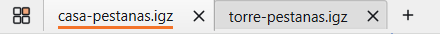
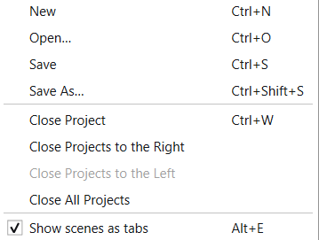
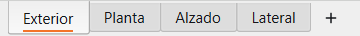
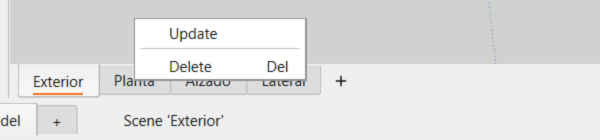
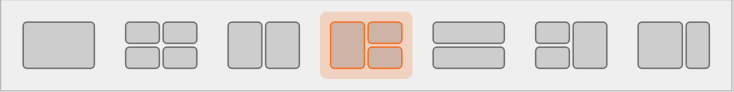
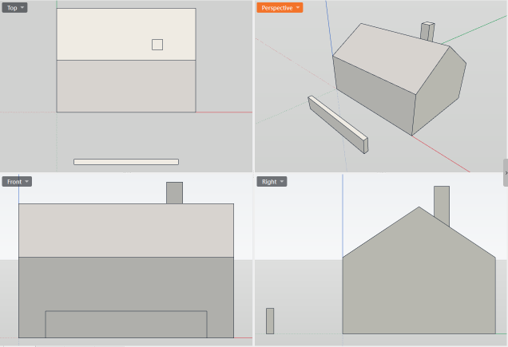
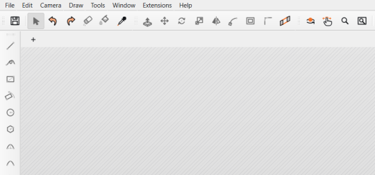

# Project tabs, scenes and views

Several projects can be open in one window, each in its own tab. Under the
view, the project's scenes are tabs too; the button at the left of the
project tabs shows the model in one, two, three or four views at once.

Everything in this manual can be tried with the example document
`examples/pestanas-prueba.igz` (see [Example document](#example-document)): a
house with four scenes; open another document beside it to see two tabs.

---

## 1. Project tabs

| Part | What it does |
|---|---|
| Tab | One open project. The active one has a line in the accent colour under its name. A dot after the name: unsaved changes. Drag a tab to reorder; a middle click closes it. |
| × | Closes that project, asking only about its own unsaved changes. |
| **+** | A new project, in a tab of its own, every time. Double-clicking the empty strip right of the tabs does the same. |
| Four squares | The view layouts of the project in front (see [3. View layouts](#3-view-layouts)). |

**File ▸ Open**, Open Recent, a double-click on a file and the command line
open the document in a new tab, or bring its tab to the front when it is
already open. **File ▸ New** (Ctrl+N) starts an untouched *Untitled* over
in place, else makes a new tab.

### Right-click on a tab

The project right-clicked comes to the front first, so **Save** and
**Save As** act on it.

| Entry | What it does |
|---|---|
| New, Open…, Save, Save As… | As in the File menu. |
| Close Project | Closes this one (Ctrl+W). |
| Close Projects to the Right / to the Left | Closes the tabs on that side, one by one; each asks about its own changes, and Cancel stops there. Greyed out when there are none on that side. |
| Close All Projects | Closes them all: the [empty area](#4-every-project-closed) is left. |
| Show scenes as tabs | This project's scene row on or off (Alt+E). |

### Keys

| Keys | What they do |
|---|---|
| Ctrl+W | Close the project in front |
| Ctrl+PgDown / Ctrl+PgUp | Next / previous project |
| Ctrl+Tab | With several projects, the next one; with one, the sheets |
| Alt+E | The scene row of the project in front, on or off |

---

## 2. Scenes as tabs

Under the view, the scenes of the project in front, in their order — the
same scenes as in the **Scenes** panel.

| Action | What it does |
|---|---|
| Click on a scene | Shows it (as a double-click in the Scenes panel) and marks it with the accent line. |
| **+** after the last scene | Keeps the current view as a new scene. |
| Right-click on a scene | Its menu, and nothing else: the view does not change. |
| Right-click on the bar, off the tabs | **Hide scenes**. |

| Entry | What it does |
|---|---|
| Update | Keeps the current view in this scene. |
| Delete | Deletes the scene; Ctrl+Z brings it back. |

Both menus open upwards, from the foot of the window.

The row is on for every project; each project keeps its own choice. Turn it
off or on with **Alt+E**, **Window ▸ Show scenes as tabs**, the project
tab's menu, or **Hide scenes** on the bar. A project without scenes shows
**+** and a line saying how to make the first one.

---

## 3. View layouts

The four-squares button left of the project tabs opens the layouts, drawn
as their panes. One view is always first; the rest go from the most used.

| Layout | Views |
|---|---|
| One view | The 3D view alone (as a project opens). |
| Four views | Top, Perspective, Front and Right. |
| Two views | Top and Perspective, side by side. |
| Three views | Perspective large on the left; Top over Front on the right. |
| Two views, one above the other | Perspective above, Top below. |
| Three views, the large one on the right | Top over Front on the left; Perspective large on the right. |
| Two views, one wider | Perspective wide, Top narrow. |

- Each project keeps its own layout, the cameras of its views and the view
  filling the area; a new project opens in one 3D view. Choosing a layout
  does not mark the document as changed.
- Every view shows its name in a small label in its corner; the view being
  worked in wears the accent colour. Click the label for the standard views
  (Top, Front, Right, Back, Left, Bottom, Isometric, Perspective); a
  double-click fills the area with that view, another brings the others
  back. A view picked by hand stays through layout changes.
- All the views draw the same model with the same undo: what is drawn,
  selected or undone in one shows in all. Each view picks up the tool in
  hand as the mouse comes in.
- **Zoom Extents** frames every view shown.
- Drag the lines between the views to resize them.

---

## 4. Every project closed

Closing the last project leaves the work area empty and hatched, with only
**+** above it: no tabs, no layouts button, no scene row, no side panels,
no sheets strip, no tools.

**+**, **File ▸ New**, **File ▸ Open** or a document dragged onto the area
(.igz, .dae, .skp, .dxf, .dwg, and the types of the extensions installed)
bring a project back, and the panels come back as they were. Quitting from
the empty area keeps the panel arrangement for the next session.

---

## Example document

`examples/pestanas-prueba.igz` (made by `examples/pestanas-prueba.py`) is a
house 8 × 6 × 3 m with a pitched roof, a chimney and a low wall in front,
easy to tell apart from every side:

| Scene | View |
|---|---|
| Exterior | Isometric |
| Planta | Top |
| Alzado | Front |
| Lateral | Right |

To try the tabs, open it and any other document of `examples/` beside it.
