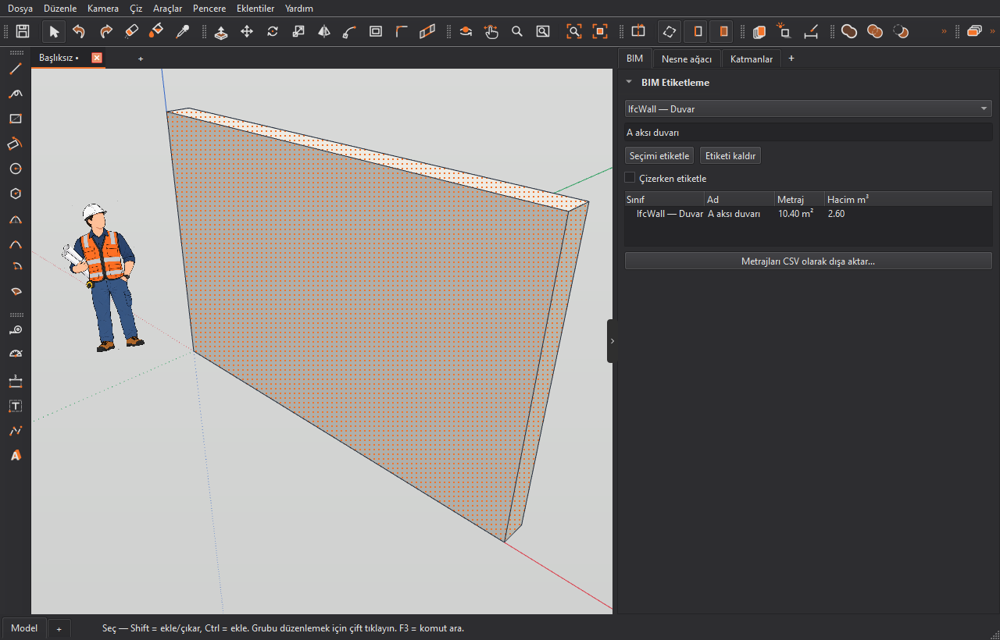
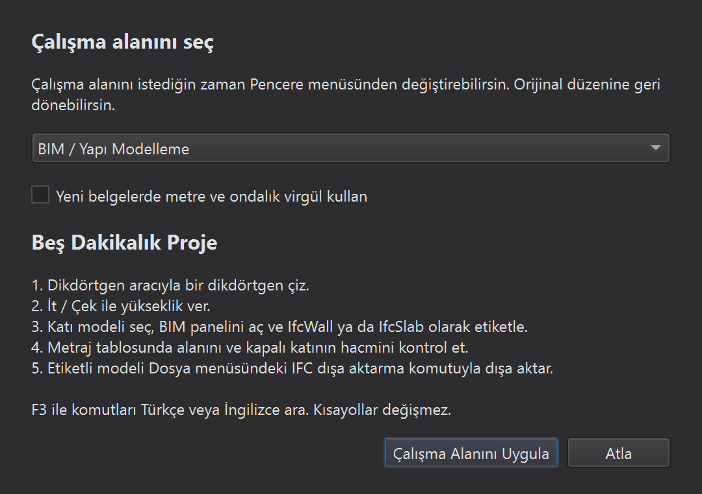

# Turkish localization and workspace guide

This contribution adds Turkish (`tr`, Türkçe) without changing IngeTrazo's
identity, document format, command IDs, shortcuts or IFC schema. Language
selection uses the existing restart-based preference. Qt's own Turkish
catalogue translates standard buttons without translating shortcut key names.

## Source reconciliation

Base: `e61132a7f8a098ca77fb6b0e7cac488c1bd410cb`, fetched from upstream on
2026-11-05. The handoff has 3,276 entries. Nine keys lost a leading space in
the handoff; these were matched to the exact original keys and their Turkish
boundary spaces restored. No upstream messages were added or removed since
the earlier source snapshot. The implementation adds 16 IFC display labels
and 20 workspace/guide/search/credit messages: **3,312 canonical keys**, all present
and nonempty in Turkish. Other catalogues retain their original translations;
the new messages use readable English until their translators review them.

A literal `tr()` scan also finds four intentional identity fallbacks outside
the canonical catalogue: `+`, `⧉`, `IngeTrazo`, and `Wayland`. Dynamic labels
continue to use the existing English fallback when no catalogue entry exists.
Translation coverage is not a claim of complete linguistic or domain review.

## IFC boundary

The class picker stores `IfcWall`, `IfcSlab`, etc. as Qt item data. Display
text may say `IfcWall — Duvar`; tagging and tag-as-you-draw read **item data**,
never that display text. The takeoff tree shows the same annotated label.
No serializers, class inventories, property/schema keys or exporters were
localized. Unsupported IFC classes are not offered just because the reference
dictionary contains a label for them.

`terminology/tr_ifc_labels.json` preserves the supplied 136-label terminology
reference and its provenance. It is documentation, not a runtime dependency
or a schema modification. The app currently offers 16 curated classes; 15
use the supplied reference, while `IfcReinforcingBar — Donatı Çubuğu` is a
conventional translation awaiting domain review. No regulatory applicability
or compliance certification is asserted. IFC **import is not added**.

Display quantities respect the document's decimal separator; numeric CSV and
IFC serialization remain unchanged. The original `Space` key name is kept in
selection/browser hints, distinct from spatial/IFC concepts.

## Reversible workspaces

Window > Workspace offers four explicitly selected layouts:

| Layout | Existing facilities emphasized |
| --- | --- |
| Original IngeTrazo | The layout saved before changing profile; factory fallback if none exists |
| CAD / Technical Drawing | Draw, modify, annotation, section, layers and camera tools |
| BIM / Building Modeling | Existing Browser/group hierarchy, layers, BIM tags and quantities |
| Easy 3D Modeling | Draw, modify, selection and camera tools; properties |

Each profile remembers its customized Qt layout, panel visibility and folded
sidebars under `workspace_profiles/`. Window > Panels and toolbar toggles
remain available; presets never remove actions or change key assignments.
Until a profile is explicitly selected, workspace persistence stays inactive
and the existing upstream window-state behavior is left in control.
Extension panels and toolbars are not assigned preset visibility. Returning
to Original restores its captured state rather than resetting a user's work.

The existing shortcut editor remains the explicit, conflict-aware way to
customize keys. Vendor shortcut emulation is not included in this slice.

The first Turkish startup offers a skippable guide after extensions load and
only when no document was passed on the command line. Window > Workspace >
Getting started reopens it. Apply is required to change a workspace. An
unchecked option can set **future** documents to metres/decimal comma;
existing documents are untouched. Preferences > Units can change it later.

F3 already searches translated and English names. Added aliases include
Öteleme/Offset and Katılaştırma/Push/Pull. Search folding additionally treats
Turkish dotted and dotless i consistently; it does not alter identifiers or
user text.

## Five-minute Turkish task

1. Dikdörtgen çiz ve İt / Çek ile yükseklik ver.
2. Katı modeli seç; BIM panelinde `IfcWall — Duvar` seçip etiketle.
3. Metraj tablosunda alanı ve yalnız kapalı katılar için hacmi kontrol et.
4. Dosya menüsündeki IFC dışa aktarma komutunu kullan.
5. F3 ile `öteleme`, `offset`, `katılaştırma` veya `push pull` ara.

## Validation

Run `python scripts/verify_turkish.py` for exact canonical key coverage,
duplicate/empty entries, formatting fields, schema tokens, extensions,
markup, printf fields, newlines and boundary spaces. Run the existing
translation/system-language/Qt-translator tests plus
`tests/test_turkish_workspace.py`, BIM, units and IFC suites.

The new regressions cover system locale and saved language, fallback, IFC
picker data, tag-as-you-draw, `.igz` persistence, IFC export, decimal-comma
takeoff, profile switching/restoration/persistence, folded-sidebar recovery,
unchanged shortcuts, skipped introduction, future-document defaults and
bilingual command discovery. See the accompanying validation report for
actual run counts and environment-specific limitations.

On Windows, tests that launch Python subprocesses need the installed Python
packages to remain discoverable after `tests/conftest.py` isolates APPDATA.
Use an explicit package `PYTHONPATH` for that test environment. `PYTHONUTF8=1`
also avoids locale-codepage failures in upstream tests that read UTF-8 source
with `Path.read_text()` and no encoding. These are test-run settings, not
application environment requirements or changes to the upstream runner.

Native Windows screenshots at 100% and 200% scaling verify the new guide and
BIM panel with an actual OpenGL context and a modeled/tagged 4 × 0.25 × 2.6 m
wall. The exported file is readable as IFC4/IfcWall by IfcOpenShell. These
are engineering checks, not a user study or a full review of all 3,312 strings.

Linux, macOS, screen-reader use and installer binaries remain untested here.
Further iterations can add deeper guided tasks and more aliases based on
domain feedback. Branding, app IDs, icons and update channels are unchanged.

Turkish contribution: [h-skycloud](https://github.com/h-skycloud), building
on IngeTrazo by Marco Sumari Tellez and contributors, GPL-3.0-or-later.
