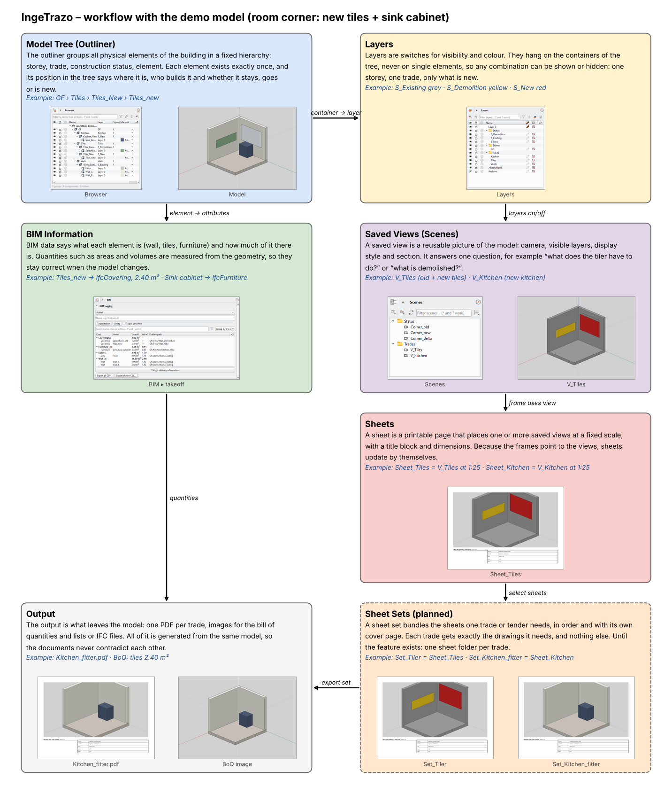
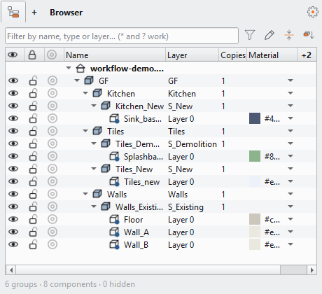
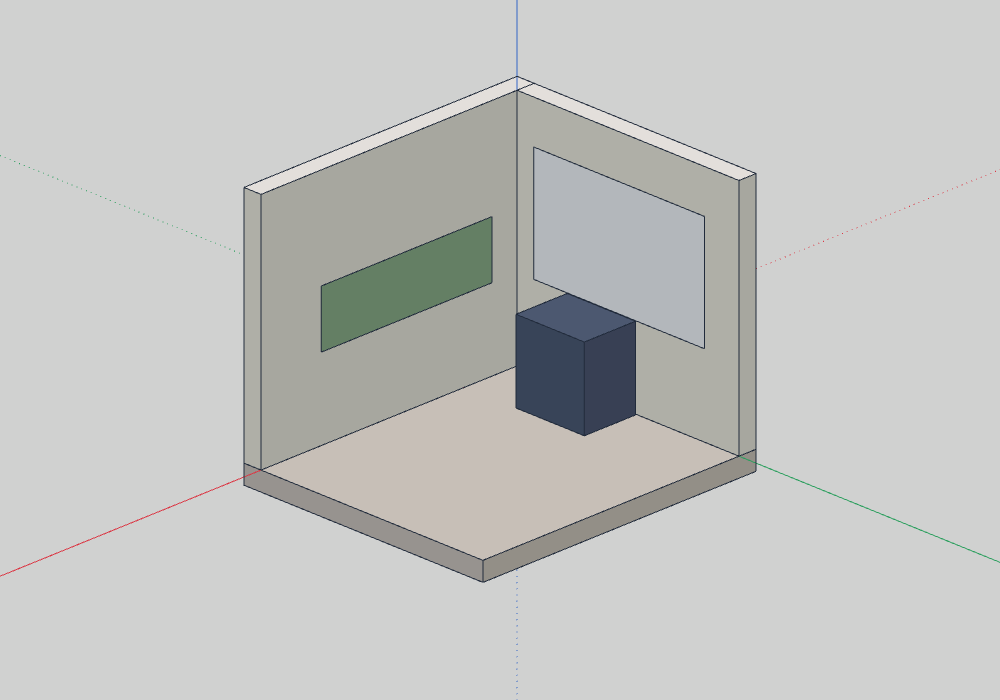
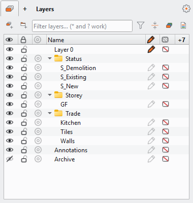
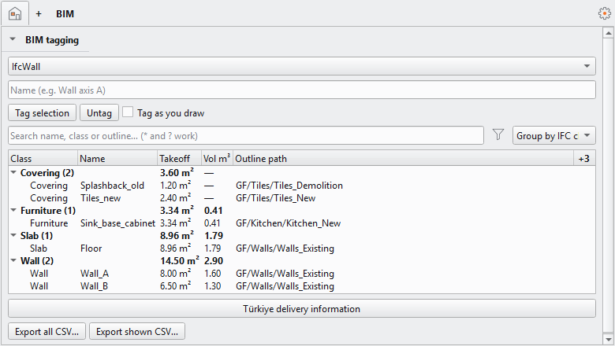
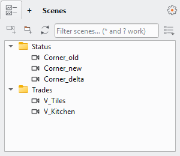
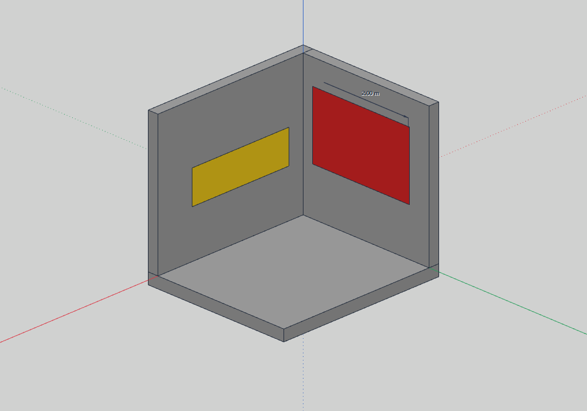
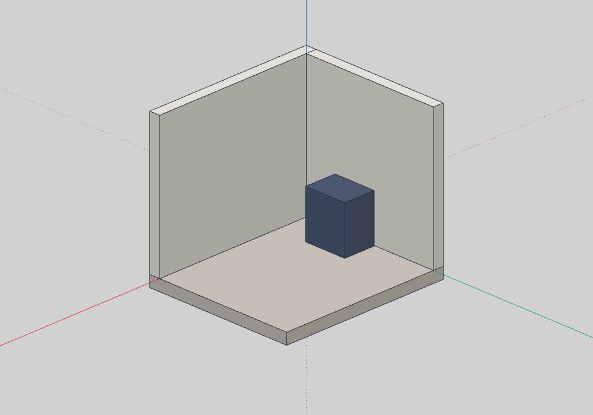
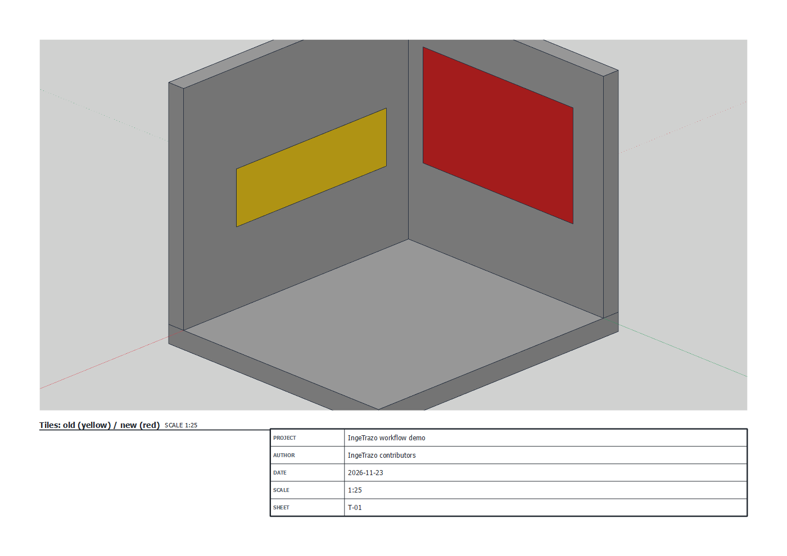
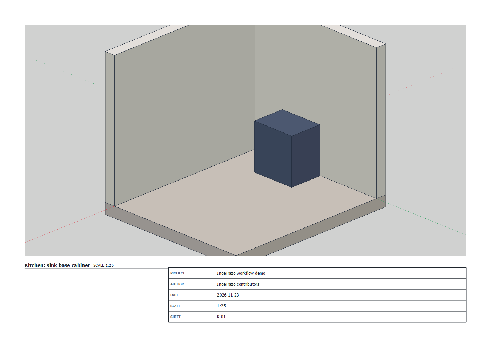

# IngeTrazo workflow – a minimal example

How model tree, layers, BIM data, saved views, sheets and sheet sets fit
together, shown on the smallest model that uses all of them: **one room
corner** where an old tile splashback is removed and a sink cabinet with new
tiles is added on the other wall.



| File | What it is |
|---|---|
| `workflow-demo.igz` | the demo model – open it with **File ▸ Open** |
| `workflow-flowchart.drawio` / `.png` | the flow chart above (editable in draw.io, screenshots embedded) |
| [`AI-INSTRUCTIONS.md`](AI-INSTRUCTIONS.md) | the same workflow as rules for an AI assistant |
| `images/` | the screenshots used here |
| `create-demo/` | scripts that rebuild the model (`workflow-demo.py`) and the flow chart (`make_flowchart.py`) |

## 1. Model tree (Outliner)

The outliner groups all physical elements of the building in a fixed
hierarchy: **storey → trade → construction status → element**. Each element
exists exactly once, and its position in the tree says where it is, who
builds it and whether it stays, goes or is new. Containers carry the layers;
elements carry none and inherit them.

```
GF                       [GF]
├─ Walls                 [Walls]
│  └─ Walls_Existing     [S_Existing]    Floor, Wall_A, Wall_B
├─ Tiles                 [Tiles]
│  ├─ Tiles_Demolition   [S_Demolition]  Splashback_old
│  └─ Tiles_New          [S_New]         Tiles_new
└─ Kitchen               [Kitchen]
   └─ Kitchen_New        [S_New]         Sink_base_cabinet
```

| Browser | Model |
|---|---|
|  |  |

## 2. Layers

Layers are switches for visibility and colour. They hang on the containers
of the tree, never on single elements, so any combination can be shown or
hidden: one storey, one trade, only what is new.

The demo has three kinds of layer in three folders: storey (`GF`), trade (`Walls`,
`Tiles`, `Kitchen`) and status (`S_Existing` grey, `S_Demolition` yellow,
`S_New` red). `Archive` is hidden everywhere; `Annotations` holds the
dimension.



## 3. BIM information

BIM data says what each element is (wall, tiles, furniture) and how much of
it there is. Quantities such as areas and volumes are measured from the
geometry, so they stay correct when the model changes. The tiles
are single faces, so their takeoff is exactly their area: new tiles
**2.40 m²**, old splashback 1.20 m². The *Outline path* column shows where each
element sits in the tree.



## 4. Saved views (scenes)

A saved view is a reusable picture of the model: camera, visible layers,
display style and section. It answers one question, for example “what does
the tiler have to do?” or “what is demolished?”. The demo has the status set (`Corner_old`, `Corner_new`,
`Corner_delta`) and one view per trade:

- `V_Tiles` – *Kitchen* hidden, style *Delta* (colour by layer):
  old tiles yellow, new tiles red.
- `V_Kitchen` – *Tiles*, *S_Demolition* and *Annotations* hidden.



| V_Tiles | V_Kitchen |
|---|---|
|  |  |

## 5. Sheets

A sheet is a printable page that places one or more saved views at a fixed
scale, with a title block and dimensions. Because the frames point to the
views, sheets update by themselves. In the demo each sheet has one frame
(parallel projection, 1:25) and a title block with project, author, date,
scale and sheet number.

| Sheet_Tiles (T-01) | Sheet_Kitchen (K-01) |
|---|---|
|  |  |

## 6. Sheet sets (planned) and output

A **sheet set** bundles the sheets one trade or tender needs, in order and
with its own cover page. Each trade gets exactly the drawings it needs, and
nothing else. Until the feature exists, the demo uses one **sheet folder per
trade**:

- `Set_Tiler` → `Sheet_Tiles` → *Tiler.pdf* + 2.40 m² of tiles
- `Set_Kitchen_fitter` → `Sheet_Kitchen` → *Kitchen_fitter.pdf* + 1 sink cabinet

The **output** is what leaves the model: one PDF per trade, images for the
bill of quantities and lists or IFC files. All of it is generated from the
same model, so the documents never contradict each other.
