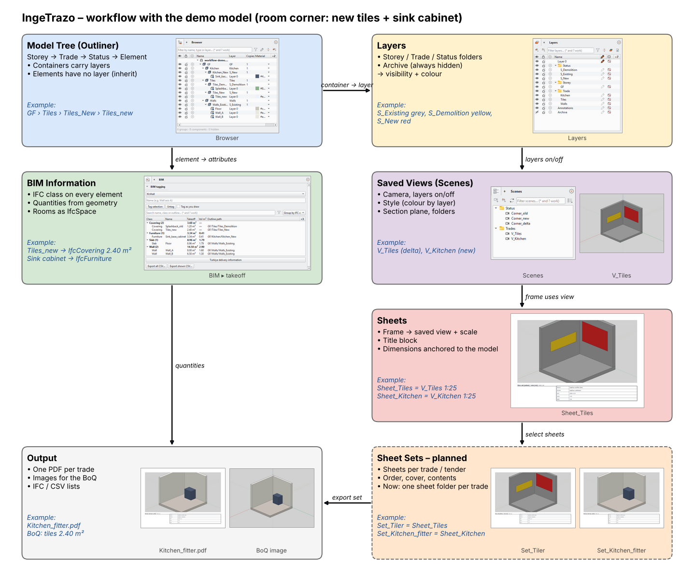
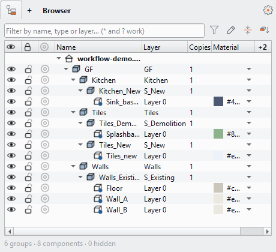
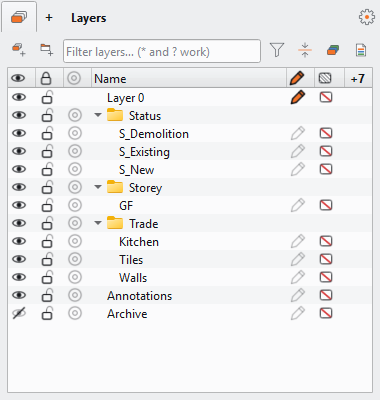
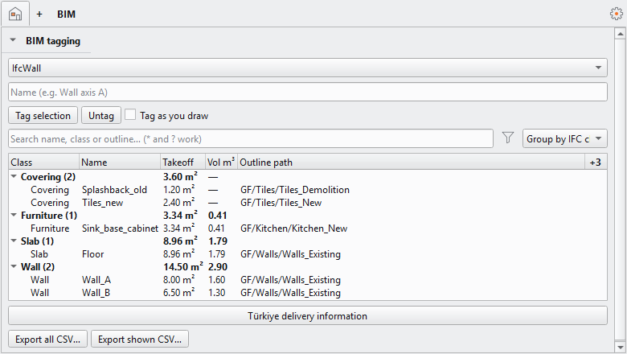
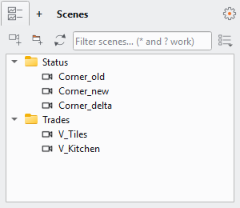
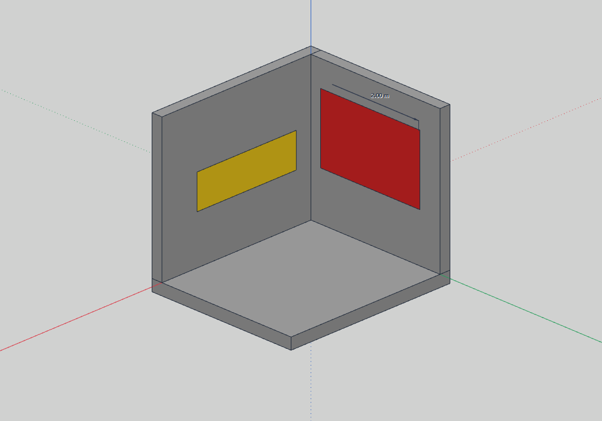
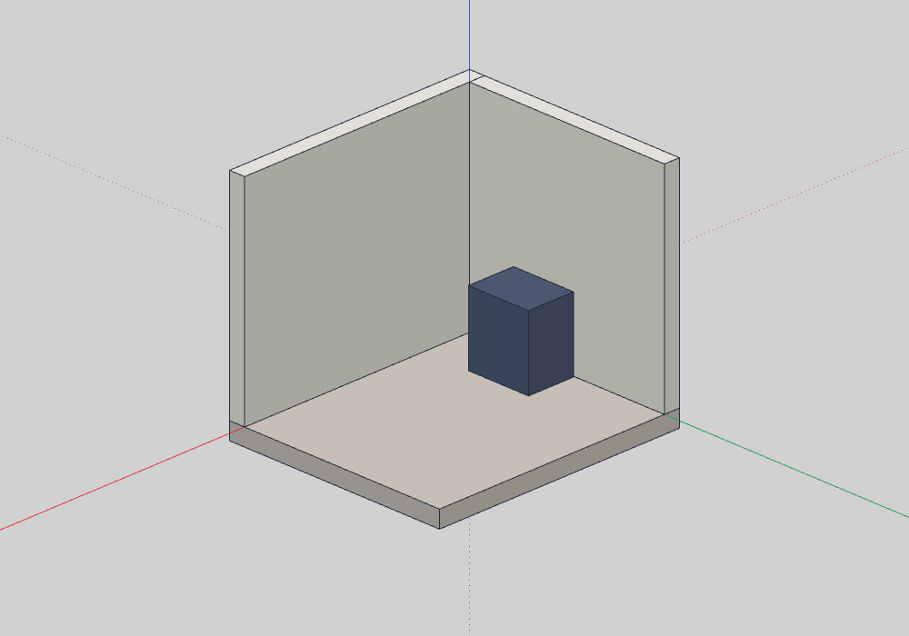
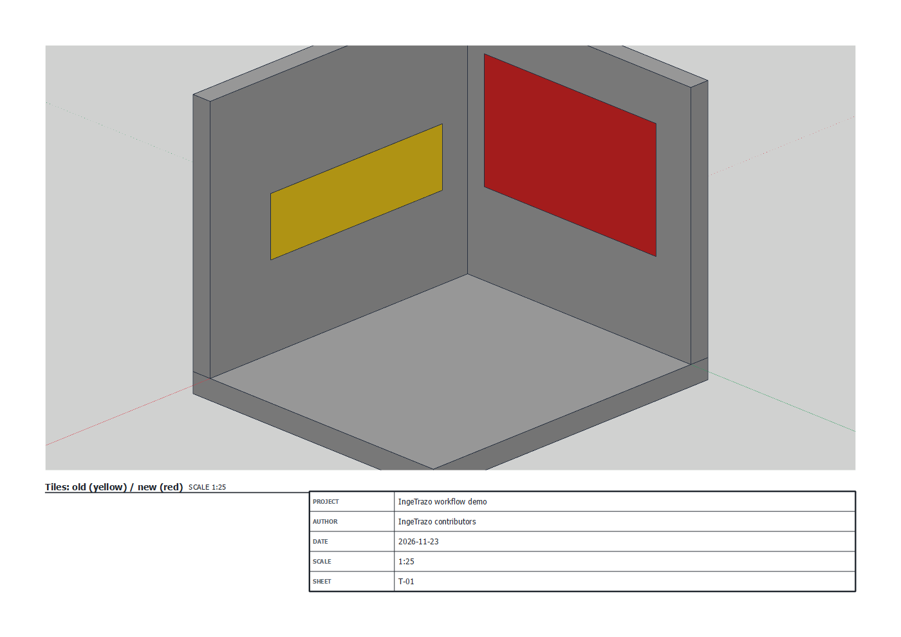
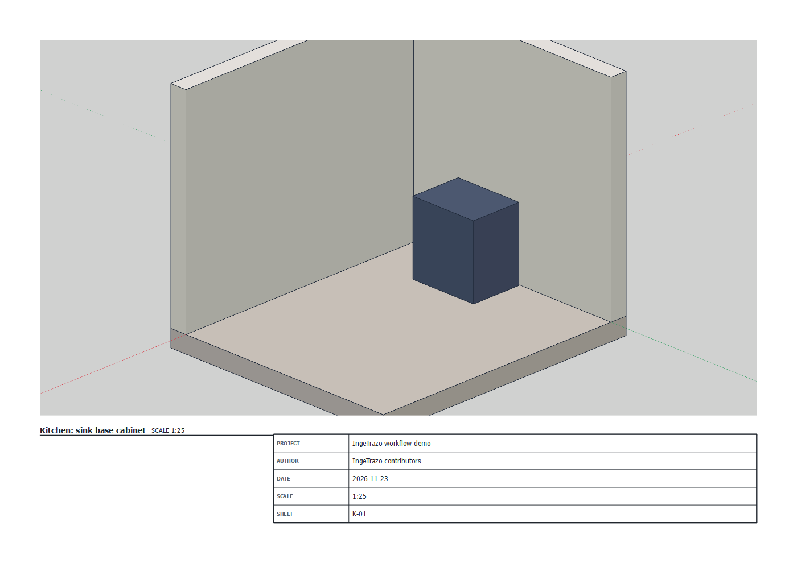

# IngeTrazo workflow – a minimal example

How model tree, layers, BIM data, saved views, sheets and sheet sets fit
together, shown on the smallest model that uses all of them: **one room
corner** where an old tile splashback is removed and a sink cabinet with new
tiles is added on the other wall.



| File | What it is |
|---|---|
| `workflow-demo.igz` | the demo model – open it with **File ▸ Open** |
| `workflow-demo.py` | builds `workflow-demo.igz` (`python examples/workflow-demo/workflow-demo.py` from the IngeTrazo folder) |
| `workflow-flowchart.drawio` / `.png` | the flow chart above (editable in draw.io, screenshots embedded) – `make_flowchart.py` redraws it |
| `AI-INSTRUCTIONS.md` | the same workflow as rules for an AI assistant |
| `images/` | the screenshots used here |

## 1. Model tree (Outliner)

Every model follows **Storey → Trade → Status → Element**. Containers carry
the layers; elements carry none and inherit them.

```
GF                       [GF]
├─ Walls                 [Walls]
│  └─ Walls_Existing     [S_Existing]    Floor, Wall_A, Wall_B
├─ Tiles                 [Tiles]
│  ├─ Tiles_Demolition   [S_Demolition]  Splashback_old
│  └─ Tiles_New          [S_New]         Tiles_new
└─ Kitchen               [Kitchen]
   └─ Kitchen_New        [S_New]         Sink_base_cabinet
```



## 2. Layers

Three kinds of layer in three folders: storey (`GF`), trade (`Walls`,
`Tiles`, `Kitchen`) and status (`S_Existing` grey, `S_Demolition` yellow,
`S_New` red). `Archive` is hidden everywhere; `Annotations` holds the
dimension. Because a hidden container layer hides everything below it,
storey, trade and status can be switched independently.



## 3. BIM information

Every element has an IFC class; quantities come from the geometry. The tiles
are single faces, so their takeoff is exactly their area: new tiles
**2.40 m²**, old splashback 1.20 m². The *Outline path* column shows where each
element sits in the tree.



## 4. Saved views (scenes)

A saved view stores the camera, the hidden layers, the display style and the
section plane. The demo has the status set (`Corner_old`, `Corner_new`,
`Corner_delta`) and one view per trade:

- `V_Tiles` – *Kitchen* hidden, style *Delta* (colour by layer):
  old tiles yellow, new tiles red.
- `V_Kitchen` – *Tiles*, *S_Demolition* and *Annotations* hidden.



| V_Tiles | V_Kitchen |
|---|---|
|  |  |

## 5. Sheets

A sheet holds frames; each frame shows one saved view at a fixed scale
(parallel projection, 1:25) and the title block carries project, author,
date, scale and sheet number.

| Sheet_Tiles (T-01) | Sheet_Kitchen (K-01) |
|---|---|
|  |  |

## 6. Sheet sets (planned) and output

A **sheet set** is the selection of sheets one trade or tender receives, in
order, with its own cover and contents page, exported as one PDF. Until the
feature exists, the demo uses one **sheet folder per trade**:

- `Set_Tiler` → `Sheet_Tiles` → *Tiler.pdf* + 2.40 m² of tiles
- `Set_Kitchen_fitter` → `Sheet_Kitchen` → *Kitchen_fitter.pdf* + 1 sink cabinet

The same model, the same views and the same quantities feed every trade's
documents, so a change in the model reaches all of them.
